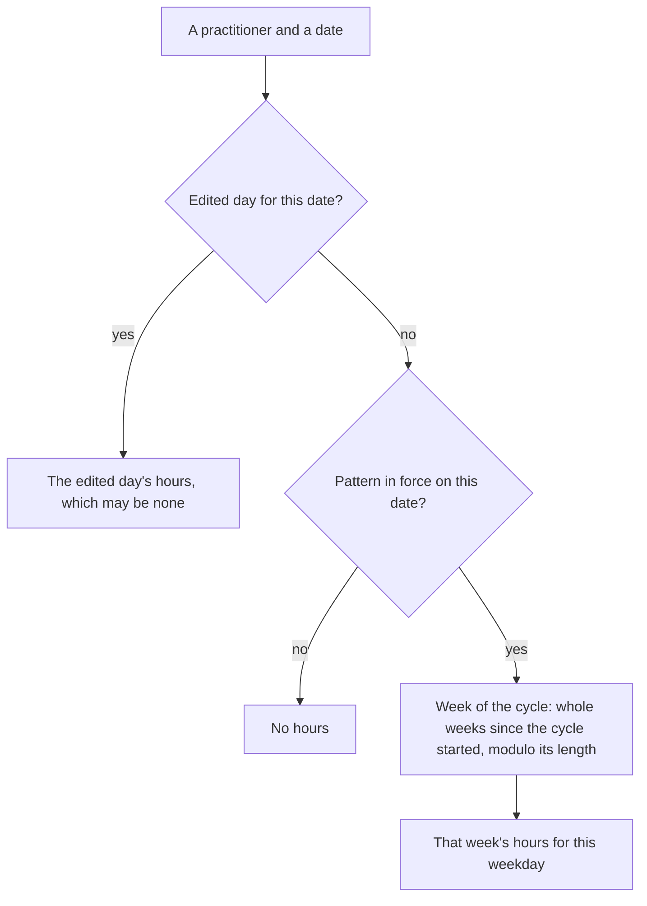
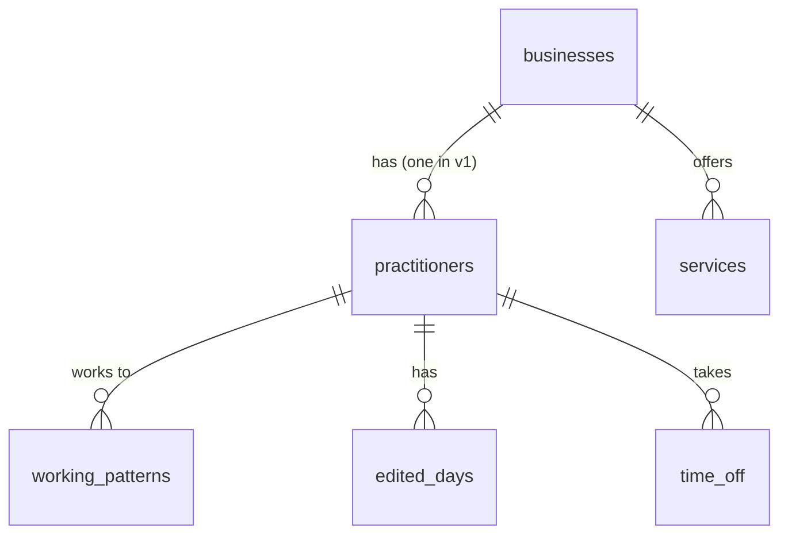

# 03 — Core data model

## Goal

Create the tables and models the scheduling engine is built on: businesses with their booking settings, the practitioner whose diary is booked, services, working hours and time off. Bookalive v1 is for one person who works for themselves, so each business has exactly one practitioner. But the tables are laid out so staff can be added after v1 without moving any data. Every tenant-owned query is scoped to the current business automatically, the database refuses data that mixes two businesses, and a sample business seeds local development. There are no admin screens yet.

## Depends on

01 (project setup) and 02 (CI and deployment).

## Scope

**In scope**
- `businesses`, with the time zone, slot interval and booking window
- Automatic tenant scoping: the current business, a global scope that fails closed, and isolation tests
- `practitioners`: exactly one per business in v1
- `services`, with a length, buffers before and after, and a price
- Working hours: repeating working patterns (1 to 4 weeks), edited days, and plain PHP that works out the practitioner's hours on any date
- `time_off`
- Casts that keep times in UTC and keep hours valid
- Factories for every model, and a sample business for local development, which the playground (08) reuses
- Updates to the overview and `background.md`: the v1 scope, core concepts, how slots are calculated, the data model sketch, the sub-plan table, out of scope and open questions

**Out of scope**
- Staff, after v1: more than one practitioner or login per business, which practitioners offer which services, their own prices, lengths, buffers and booking windows, roles, and what the owner lets staff do. See **Ready for staff later**
- Admin screens, and the actions that edit hours: setting new hours from a date, editing a day, resetting to the pattern, and flagging bookings that end up outside new hours (all 10)
- Week templates and hours snapshots (after v1; see the overview's open questions)
- Linking the user to their business (09)
- Middleware that sets the current business (first in 08)
- The business's URL slug, logo and brand colour (10 or 11)
- Strictness and the relaxation window (07)
- Customers and bookings (05)
- Rooms and equipment, and working hours that run past midnight (out of scope for v1)

## Decisions

The user's answers to this plan's questions (2026-10-29 and 2026-10-30):

| Question | Answer |
|---|---|
| Who is v1 for? | One person who works for themselves: one login and one practitioner per business, with full control over everything. Staff come after v1, and the tables are designed so they can be added without moving data |
| Is there a separate practitioner? | Yes. The practitioner is the person's diary: hours, time off and bookings belong to it, and the database allows exactly one per business in v1 |
| Longest pattern | 1 to 4 weeks: weekly, fortnightly, 3-weekly or 4-weekly |
| How long a pattern applies | From a start date until it's replaced, with an optional end date. Only one pattern is in force on any date. When a pattern covers only part of another's time, such as summer hours from June to August, the old one resumes afterwards and keeps its rhythm |
| Edited weeks | Stored per day. Days edited by hand keep their edits when the pattern changes, show as edited, and can be reset to the pattern. The rest of the week follows the pattern |
| Bookings outside new hours | Never moved or cancelled automatically. They're flagged for the owner (10 and 13) |
| Week templates and snapshots | After v1. How useful they are depends on how hours and the dynamic slots work in practice, so they're decided once there's a first version to try. From the answers so far: a template would copy its hours when applied, and a snapshot would cover one practitioner. Whether a snapshot includes strictness is open |
| Buffers | Set on each service, before and after, defaulting to zero. They stay inside working hours, and back to back they add up. Per-practitioner buffers come with staff |
| Prices and lengths | Set on each service. Per-practitioner prices and lengths come with staff. Lengths the customer chooses (a 30, 60 or 90-minute massage) are separate services in v1 |
| Booking window | Set for the business: 2 hours' notice and up to 90 days ahead by default. Per-practitioner windows come with staff |
| Start times | Every 15 minutes by default, with 10, 15, 20, 30 or 60 as the choices. Every 5 minutes isn't offered, because times like 09:05 look odd to customers |
| Sample business | A made-up independent physio and sports massage therapist, with a fortnightly pattern and six services from 30 to 90 minutes |

Already settled on 2026-10-29: hours are stored as rules (patterns and edited days) rather than written out for every date, buffers can go before and after an appointment, and rooms and equipment are out of scope for v1.

**What "inside working hours" means for buffers.** Start times sit on the clock (09:00, 09:15 and so on), and a booking's buffers must fit inside the practitioner's hours. So with hours from 09:00 and a 15-minute setup, the first time offered is 09:15, with setup from 09:00. To offer 09:00, the hours start at 08:45. A buffer that isn't a multiple of the start-time interval leaves a few minutes nobody can book, which the waste score (06) will show.

## Design

### Ready for staff later

**Nothing belongs to a user.** The business is the tenant, and everything else belongs to the business or to its practitioner: hours, time off, services and bookings. A login (09) only gives access to a business. So adding staff after v1 means adding things beside what's there, and no data moves:

| After v1 | How it's added |
|---|---|
| More practitioners | Drop the unique index on `practitioners.business_id`. Hours, time off and bookings already belong to a practitioner |
| Which practitioners offer which services, with their own price, length and buffers | A `practitioner_service` table with nullable overrides, filled by linking every existing service to the existing practitioner. It needs a custom pivot model that uses `BelongsToBusiness`. Laravel's `withPivotValue('business_id', ...)` can't fill the column, because eager loading calls the relation on an empty model and `withPivotValue` refuses a null value (checked in Laravel 13's source) |
| Practitioners' own booking windows | Nullable columns on `practitioners`, falling back to the business's |
| More logins, roles and permissions | A role on users (existing users become owners) and a nullable `practitioners.user_id` |
| Customers choosing a practitioner, "anyone available", and the best-fitting practitioner | The engine (04) already works one practitioner at a time and is given the business's practitioners, so it's a list of one in v1 |

v1 code that needs "the" practitioner asks for it in one way, `$business->practitioners()->sole()`, so the places to change later are easy to find. `sole()` throws if there isn't exactly one.

### Tenancy

Every tenant-owned model uses a `BelongsToBusiness` trait. The trait adds a global scope that filters every query by the **current business**, held by a `CurrentBusiness` service for the length of one request or job. Entry points set the current business: the playground from the visitor's sandbox (08), the admin area from the logged-in user (09), and the public booking page from the URL (11). Scheduling code is still given its business explicitly. The scope is a safety net under it. Even with one user per business, there are many businesses, and every playground sandbox is one too.

**With no current business, querying a tenant-owned model throws** `MissingCurrentBusiness`. Code that really works across businesses, such as deleting expired sandboxes (08), says so with `withoutGlobalScope(BusinessScope::class)`, which is easy to search for.

| Option | Trade-off |
|---|---|
| **Global scope that fails closed (chosen)** | A forgotten entry point is a loud error, never a leak. Console code has to set a business or opt out explicitly |
| Global scope that doesn't filter when no business is set | Convenient for console code, but a route that forgets to set the business shows every business's data |
| No global scope: always query through `$business->services()` | Nothing hidden, but one forgotten `where` leaks data, and route model binding isn't scoped |
| A tenancy package, such as `stancl/tenancy` | Covers far more than this needs (separate databases, domains, tenant-aware queues and caches). This needs a trait, a scope and a small service |

**The database also refuses mixed-up data.** Each table that others point to (`practitioners` and `services` here, `customers` in 05) has a unique key on `(business_id, id)`, and child tables reference their parent through **composite foreign keys** that include `business_id`. For example, `time_off (business_id, practitioner_id)` references `practitioners (business_id, id)`. So a child row's `business_id` can never disagree with its parent's, even through a bug or raw SQL, and 05's bookings can't point at another business's service. Checked locally: Laravel's `foreign([...])->references([...])` creates these on PostgreSQL 18, and they reject a cross-business link.

### Working hours

The practitioner's **working hours** on a date come from one of two places:
- an **edited day** for that date, if there is one: hours entered by hand that replace the pattern's for that one date, possibly none
- otherwise, the **working pattern** in force on that date: a cycle of 1 to 4 weeks of hours, repeated from a start date until an optional end date

Hours are only ever when the person is available. The times customers can book are never stored; the engine works them out from the hours, time off, bookings and strictness each time (04 to 07).



**A pattern's cycle** starts on a Monday, `cycle_starts_on`, the first day of week 1. It's kept separate from `starts_on`, the first date the pattern is in force, for two reasons:
- a pattern can start mid-week ("new hours from Wednesday") and still count its weeks from a Monday
- when a temporary pattern ends and the old one resumes, the resumed part is stored as a new row with the old `cycle_starts_on`, so a fortnightly rhythm carries on unbroken

**Only one pattern is in force on any date.** An exclusion constraint refuses two patterns for the same practitioner whose dates overlap. Applying a pattern for part of another's time trims the old one and stores the part after as a new row. For example, summer hours applied to a fortnightly pattern that started in January:

| Row | `starts_on` | `ends_on` | `cycle_starts_on` |
|---|---|---|---|
| Fortnightly pattern | 2026-01-05 | 2026-05-31 | 2026-01-05 |
| Summer hours | 2026-06-01 | 2026-08-31 | 2026-06-01 |
| Fortnightly pattern, resumed | 2026-09-01 | (none) | 2026-01-05 |

The tables support this now. The screens that do it are 10's, and 10 may start with plain "new hours from a date" and add temporary patterns once the basics have been tried.

Edited days are separate rows, so changing patterns never touches them. Time off (holidays, sickness) is separate again. The engine (04) subtracts it from the hours.

**Hours are local clock times** with no date or time zone, such as 09:00 to 13:00. Turning them into real times on a date, using the business's time zone, is the engine's job (04). So 09:00 stays 09:00 when the clocks change.

**How hours are stored** was the big decision here:

| Option | Trade-off |
|---|---|
| Write out every date | "All future weeks" has no end, so it would need a cut-off, and changing a pattern rewrites every future week. Rejected on 2026-10-29 |
| **Rules, with each pattern's and edited day's hours in a `jsonb` column, checked by value objects (chosen)** | One row per pattern or edited day, so a pattern copies as one value when it's split, or if templates or snapshots arrive later. The value objects check every time range when it's read or written. The database only checks the shape (an array of 1 to 4 weeks) |
| Rules, with each time range as its own row | The database can check each range, but refusing overlapping ranges needs an exclusion constraint on a custom time range type. Patterns and edited days would need two near-identical tables, and copying a pattern means copying dozens of rows |

Nothing writes these tables except through the models, so the value objects see every write. Reading a row with invalid hours throws rather than guessing.

**Overlapping patterns** had an alternative too: let them overlap, with the latest-starting one winning. That handles "summer hours, then back to normal" without trimming any rows, but "which hours apply in October?" then depends on several rows, the database can't check anything, and ending a later pattern quietly brings an earlier one back. One pattern per date keeps the stored rows equal to the timeline the owner sees.

### Times and dates

**Instants are stored in UTC as `timestamptz`.** Eloquent saves a date in the time zone it carries, without converting it. Checked locally: 10:00 London time in July was stored as 10:00 UTC rather than 09:00, and a query given a London time matched the wrong row. So:
- an `AsUtcDateTime` cast converts on the way in and out, for `time_off` now and bookings in 05
- the PostgreSQL connection sets its time zone to UTC (`'timezone' => 'UTC'` in `config/database.php`), so a time sent without an offset always means UTC, locally and on Neon. It costs one short statement each time the app connects
- code that queries by time passes UTC times (noted for 04 and 05)

`created_at` and `updated_at` stay as Laravel's default `timestamp` columns, matching the existing tables.

**Dates** (`starts_on`, `date` and so on) use Laravel's `date` cast, which gives a `CarbonImmutable` at midnight UTC. The hours code reads only the calendar date of what it's given, so the time and zone of a `Carbon` passed in never shift a day. Carbon 3's `diffInDays()` returns a signed float, so the code counts whole days from the `Y-m-d` dates instead.

## Data model



Every table below except `businesses` has a `business_id` that references `businesses` with `ON DELETE CASCADE`. Deleting a business deletes everything it owns, which is how expired sandboxes go (08). Children of practitioners also cascade through their composite foreign keys. Minutes and prices are whole numbers: lengths and buffers in 5-minute steps, and prices in pence.

The first migration enables PostgreSQL's `btree_gist` extension, which the exclusion constraints need (05's bookings constraint uses it too). Neon supports it with `CREATE EXTENSION` (https://neon.com/docs/extensions/btree_gist).

**`businesses`**

| Column | Type | Rules |
|---|---|---|
| `id` | bigint | primary key |
| `name` | string(100) | |
| `timezone` | string(64) | default `Europe/London`. An IANA name, checked by the settings form in 10 |
| `slot_interval_minutes` | smallint | default 15; check: one of 10, 15, 20, 30 or 60 |
| `min_notice_minutes` | integer | default 120; check: 0 to 43,200 (30 days) |
| `max_advance_days` | smallint | default 90; check: 1 to 365 |
| timestamps | | |

Check: `min_notice_minutes < max_advance_days * 1440`, so something is always bookable.

**`practitioners`**

| Column | Type | Rules |
|---|---|---|
| `id` | bigint | primary key |
| `business_id` | bigint | unique: one practitioner per business in v1 |
| `name` | string(100) | the person's name, which can differ from the business's |
| timestamps | | |

Unique `(business_id, id)` as well, for composite foreign keys to reference. It stays when staff arrive and the v1 unique index on `business_id` goes.

**`services`**

| Column | Type | Rules |
|---|---|---|
| `id` | bigint | primary key |
| `business_id` | bigint | |
| `name` | string(100) | |
| `duration_minutes` | smallint | check: 5 to 480, a multiple of 5 |
| `buffer_before_minutes` | smallint | default 0; check: 0 to 120, a multiple of 5 |
| `buffer_after_minutes` | smallint | as above |
| `price_pence` | integer | check: 0 or more. 0 means free |
| `is_active` | boolean | default true. Inactive services can't be booked (04) |
| timestamps | | |

Unique `(business_id, id)`, for 05's bookings to reference. In v1 the practitioner offers every active service.

**`working_patterns`**

| Column | Type | Rules |
|---|---|---|
| `id` | bigint | primary key |
| `business_id` | bigint | |
| `practitioner_id` | bigint | composite foreign key to `practitioners`, cascade |
| `starts_on` | date | first date in force |
| `ends_on` | date, nullable | last date in force; null means until replaced |
| `cycle_starts_on` | date | the Monday that starts week 1 |
| `weeks` | jsonb | 1 to 4 weeks of hours (format below) |
| timestamps | | |

Checks: `ends_on` is null or not before `starts_on`; `cycle_starts_on <= starts_on`; `extract(isodow from cycle_starts_on) = 1`; `jsonb_typeof(weeks) = 'array'` and `jsonb_array_length(weeks)` between 1 and 4. Exclusion constraint: `EXCLUDE USING gist (practitioner_id WITH =, daterange(starts_on, ends_on, '[]') WITH &&)`. Index `(business_id, practitioner_id)`.

Checked locally on PostgreSQL 18: the constraint refuses a pattern that overlaps another by one day, or that overlaps an open-ended one. It allows a pattern starting the day after another ends, and the same dates for a different practitioner. The Monday and week-count checks work, and deleting a business removes its practitioners and patterns. Laravel's schema builder has no method for exclusion constraints, so that line is a `DB::statement`.

**`edited_days`**

| Column | Type | Rules |
|---|---|---|
| `id` | bigint | primary key |
| `business_id` | bigint | |
| `practitioner_id` | bigint | composite foreign key to `practitioners`, cascade |
| `date` | date | |
| `hours` | jsonb | one day of hours; `[]` means not working that day. Check: `jsonb_typeof(hours) = 'array'` |
| timestamps | | |

Unique `(practitioner_id, date)`; index `(business_id, practitioner_id)`.

**`time_off`**

| Column | Type | Rules |
|---|---|---|
| `id` | bigint | primary key |
| `business_id` | bigint | |
| `practitioner_id` | bigint | composite foreign key to `practitioners`, cascade |
| `starts_at` | timestamptz | UTC |
| `ends_at` | timestamptz | UTC; check: after `starts_at` |
| `reason` | string(255), nullable | for the business only (see Notes) |
| timestamps | | |

Index `(business_id, practitioner_id, starts_at)`. Periods may overlap. Time off covering whole days (10) is stored from local midnight to local midnight, converted to UTC in the business's time zone.

### Hours format

Hours are stored as JSON that the value objects in `app/Scheduling/Hours` read and write. An edited day's `hours` is one day:

```json
[["09:00", "13:00"], ["14:00", "17:30"]]
```

A pattern's `weeks` is a list of weeks, one for each week of the cycle. This one is weekly, working Monday and Tuesday:

```json
[
  {"mon": [["09:00", "13:00"], ["14:00", "17:30"]], "tue": [["10:00", "16:00"]], "wed": [], "thu": [], "fri": [], "sat": [], "sun": []}
]
```

The rules, enforced by the value objects:
- times are `HH:MM`, in 5-minute steps, from `00:00` to `24:00`
- each range starts before it ends, so it can't run past midnight
- a day's ranges are kept in order and can't overlap or touch. The gap between two ranges is a break
- a week has exactly the seven keys `mon` to `sun`, and a pattern has 1 to 4 weeks

## Backend

### Tenancy

- **`App\Services\CurrentBusiness`**, marked `#[Scoped]` so the container makes one per request or queue job and throws it away afterwards (Laravel 13's container docs). Methods:
  - `set(Business $business): void`
  - `get(): Business`, which throws `MissingCurrentBusiness` when none is set
  - `id(): int`
  - `has(): bool`
  - `forget(): void`
  - `run(Business $business, Closure $callback): mixed`, which sets the business, runs the callback and restores the previous one, even if the callback throws. Typed with `@template T`, `@param Closure(): T` and `@return T`
- **`App\Models\Scopes\BusinessScope`**, a global scope that adds `where <table>.business_id = <current business id>`, using `qualifyColumn` so joins stay unambiguous.
- **`App\Models\Concerns\BelongsToBusiness`**, a trait that:
  - adds `BusinessScope`
  - fills `business_id` from the current business on `creating`, when it's empty and a current business is set
  - defines `business(): BelongsTo`
- **`App\Exceptions\MissingCurrentBusiness`**, a `LogicException` whose message says how to set a business or opt out.

`Business` itself isn't scoped. What the scope does and doesn't cover:
- **Covered:** queries, relations, eager loading and route model binding all go through Eloquent, so they're filtered. Binding another business's service finds nothing, so the route returns 404.
- **Not covered:** jobs restore their models with `newQueryWithoutScopes()`, so a queued job can still unpack a model before it sets its business.
- **Not covered:** `DB::table()`, and the `exists` and `unique` validation rules, use the query builder, so they bypass the scope. Form Requests on tenant tables must add `->where('business_id', ...)` (10 and 11).

### Models

`Business`, `Practitioner`, `Service`, `WorkingPattern`, `EditedDay` and `TimeOff`, in `app/Models`. They follow `User`:
- `#[Fillable]` attributes
- `@property` docblocks for every column
- typed relations with generics, such as `@return HasMany<Practitioner, $this>`
- a factory

`TimeOff` sets its table with `#[Table('time_off')]`. Every model except `Business` uses `BelongsToBusiness`.

Relations:
- `Business`: `practitioners` (has many, even though v1 allows one), `services`
- `Practitioner`: `business`, `workingPatterns`, `editedDays`, `timeOff`
- `Service`: `business`
- `WorkingPattern`, `EditedDay`, `TimeOff`: `business`, `practitioner`

Casts:
- `WorkingPattern`: `starts_on`, `ends_on` and `cycle_starts_on` as `date`, and `weeks` with `AsPatternWeeks`
- `EditedDay`: `date` as `date`, and `hours` with `AsDayHours`
- `TimeOff`: `starts_at` and `ends_at` with `AsUtcDateTime`
- booleans and integers as usual

`WorkingPattern::toRepeatingPattern(): RepeatingPattern` hands a pattern to the hours code.

### Working hours code (`app/Scheduling/Hours`)

These are plain PHP value objects with no Eloquent and no database, so the engine (04) and its randomised checks can use them directly. They're all `final readonly` and throw `InvalidArgumentException` for invalid input.

| Class | Holds | Main methods |
|---|---|---|
| `LocalTimeRange` | start and end, in minutes after midnight | `fromStrings('09:00', '13:00')`, `toArray(): array{string, string}` |
| `DayHours` | a day's ranges, in order | `ranges(): list<LocalTimeRange>`, `isEmpty()`, `fromArray()`, `toArray()` |
| `WeekHours` | `DayHours` for each ISO weekday | `forWeekday(int $isoWeekday): DayHours`, `fromArray()`, `toArray()` |
| `PatternWeeks` | 1 to 4 `WeekHours` | `count()`, `week(int $index): WeekHours`, `fromArray()`, `toArray()` |
| `RepeatingPattern` | `startsOn`, `endsOn` (nullable), `cycleStartsOn`, `PatternWeeks` | `covers(CarbonInterface $date): bool`, `hoursOn(CarbonInterface $date): DayHours` (throws for a date it doesn't cover) |
| `WorkingHours` | one practitioner's patterns and edited days (keyed by `Y-m-d`) | `on(CarbonInterface $date): DayHours` |

`WorkingHours` refuses overlapping patterns, matching the database. Its signature is what 04 builds on:

```php
/**
 * @param  list<RepeatingPattern>  $patterns
 * @param  array<string, DayHours>  $editedDays  keyed by Y-m-d
 */
public function __construct(array $patterns, array $editedDays)

public function on(CarbonInterface $date): DayHours
```

The week of the cycle is `intdiv(days from cycleStartsOn to the Monday of the date's week, 7) % weeks->count()`, counting whole days from the `Y-m-d` dates. 04 adds what the engine needs, such as loading these for a date range, and turning local hours into UTC on a date.

### Casts (`app/Casts`)

- `AsUtcDateTime`, a `CastsAttributes<CarbonImmutable, CarbonInterface>`. It converts to UTC before saving and returns `CarbonImmutable` in UTC.
- `AsDayHours` and `AsPatternWeeks` encode and decode JSON with `JSON_THROW_ON_ERROR`, building the value objects so invalid hours fail in both directions.

### Configuration

`config/database.php`: add `'timezone' => 'UTC'` to the `pgsql` connection. Laravel runs `set time zone 'UTC'` when it connects.

### Sample business

**`App\Actions\CreateSampleBusiness`**, `handle(): Business`. It creates the business below, with its practitioner, in one transaction and returns it:
- **Fixed data, no Faker.** Faker is a development dependency, and 08 runs this in production for every playground visitor.
- **Sets `business_id` explicitly** rather than relying on the trait's `creating` hook, because `DatabaseSeeder` runs with model events turned off (`WithoutModelEvents`).
- **Dates are relative to now** in the business's time zone, so tests fix the date with `travelTo`.

`DatabaseSeeder` keeps the test user and calls the action.

**Alex Morgan Physio & Sports Massage** (made up; change it freely), in `Europe/London`, with the default settings. The practitioner is Alex Morgan. The pattern starts on the Monday of the current week, as week 1, with no end date:
- **Week 1:** Monday to Friday, 09:00–13:00 and 14:00–17:30
- **Week 2:** Monday to Wednesday, 09:00–13:00 and 14:00–17:30; Thursday, 12:00–20:00; Saturday, 09:00–13:00

| Service | Length | Before | After | Price |
|---|---|---|---|---|
| Physio assessment | 60 | 0 | 15 | £70 |
| Physio follow-up | 30 | 0 | 15 | £50 |
| Rehab session | 90 | 15 | 15 | £95 |
| Sports massage, 30 minutes | 30 | 0 | 15 | £35 |
| Sports massage, 60 minutes | 60 | 0 | 15 | £55 |
| Sports massage, 90 minutes | 90 | 0 | 15 | £75 |

Plus one time off (Tuesday of next week, 14:00 to 17:30 local) and one edited day (Wednesday of next week, 10:00–16:00).

This gives the engine plans what they need to see:
- a fortnightly pattern with a late day and a Saturday
- buffers after appointments, and one before
- 30, 60 and 90-minute services, for long appointments being squeezed out
- time off and an edited day

Buffers are multiples of 15 minutes, so unbookable gaps come from the times customers choose rather than from the setup itself.

### Factories

One factory for each model, with plain defaults: a business in `Europe/London`, its practitioner, a 60-minute service, and a weekly Monday-to-Friday 09:00–17:00 pattern starting this week. Each child factory takes `business_id` from its parent, so tests can't create mismatched rows by accident. It reads the parent without the scope, since tests often create data for several businesses. Useful states include `fortnightly()` and `endingOn($date)` for patterns, and `dayOff()` for edited days. The builder adds others as tests need them.

## Frontend

None.

## Tests

Read the `testing-best-practices` skill first. Unit tests need no database. Feature tests run on PostgreSQL, as always.

**Unit: hours value objects** (`tests/Unit/Scheduling/Hours/`)
- `LocalTimeRange` accepts `00:00`–`24:00` in 5-minute steps, and rejects:
  - a start at or after its end
  - times outside the day
  - times not on a 5-minute step
  - badly formed strings
- `DayHours` sorts its ranges and rejects overlapping or touching ones. An empty day is allowed, and `fromArray(toArray())` gives the same hours back.
- `WeekHours` needs exactly the seven keys. `PatternWeeks` needs 1 to 4 weeks.
- `RepeatingPattern`:
  - its first and last dates are inclusive, and with no end date it's open-ended
  - weekly
  - fortnightly weeks alternate
  - a 4-week cycle wraps around
  - a pattern starting on a Wednesday counts its weeks from that week's Monday
  - a resumed pattern whose `cycleStartsOn` is months earlier keeps its rhythm
  - the same local hours on the days either side of a clock change
  - a date passed as a London time late in the evening, or an Auckland time in the morning, still gives that calendar date's hours
- `WorkingHours`:
  - an edited day replaces the pattern
  - an empty edited day means no hours
  - an edited day works with no pattern in force
  - there are no hours before the first pattern, in a gap between patterns, or after an end date
  - overlapping patterns are rejected

**Feature: tenancy** (`tests/Feature/Tenancy/`)
- Each model only returns the current business's rows, through queries, relations and eager loading.
- Querying any tenant-owned model with no current business throws `MissingCurrentBusiness`. `withoutGlobalScope(BusinessScope::class)` sees every business.
- `run()` restores the previous business afterwards, including when the callback throws.
- Creating a model inside `run()` fills `business_id`.
- `resolveRouteBinding()` doesn't find another business's practitioner, service or pattern.
- **Guard: every tenant-owned table.** For every table with a `business_id` column, the test reads PostgreSQL's catalogue and checks that the table has a foreign key to `businesses` with `ON DELETE CASCADE`. It also checks that every model in `app/Models` whose table has `business_id` uses `BelongsToBusiness`. Later sub-plans' tables are covered without new tests.

**Feature: database rules** (`tests/Feature/Database/`)
- A second practitioner for the same business is rejected.
- The composite foreign keys reject a pattern, edited day or time off whose `business_id` differs from its practitioner's.
- Patterns:
  - overlapping dates for one practitioner are rejected, including overlapping an open-ended pattern
  - back-to-back dates are allowed
  - other practitioners are unaffected
  - `cycle_starts_on` that isn't a Monday, or is after `starts_on`, is rejected
  - `ends_on` before `starts_on` is rejected
  - 0 or 5 weeks is rejected
- Edited days: unique per practitioner and date.
- Check constraints reject:
  - a slot interval outside the five values
  - a booking window out of range, or notice longer than the advance
  - a service length, buffer or price out of range
  - time off that ends before it starts
- Deleting a business deletes all its data in every table, and leaves another business's data alone.
- Casts:
  - hours round-trip through the database
  - a row with invalid hours (written with `DB::table`) throws when read
  - 10:00 London time in July is stored as 09:00 UTC and read back in UTC
- `DatabaseConnectionTest` also asserts that the session time zone is `UTC`.

**Feature: sample business**
- `CreateSampleBusiness` creates one practitioner and the six services in the table.
- On a fixed date, `WorkingHours` built from the practitioner's patterns and edited days gives the expected hours for that week and the next, including the alternating weeks and the edited Wednesday. The time off is stored as the right UTC times.
- Called twice, it creates two separate businesses that can't see each other's data.
- It works with model events turned off, as in `DatabaseSeeder`.
- `php artisan db:seed` runs (`$this->seed()`).

## Done when

- [ ] `php artisan migrate:fresh --seed` creates the schema and the sample business locally, and `php artisan migrate:rollback` takes it back to the existing tables without errors
- [ ] Every test above passes in CI on PostgreSQL 18, with Pint and Larastan at level 9 clean
- [ ] The guard test covers every tenant-owned table and model
- [ ] The deploy after merging runs the new migrations on Neon, including enabling `btree_gist` (Fly's release command succeeds)
- [ ] `tracking.md` marks 03 as done

## Notes

**Personal data.** The practitioner's name is personal data. A time off reason could be sensitive, such as a medical appointment, so it's optional, for the business only, and never sent to customers or a public API (11). Exception messages from the value objects mention times, never names.

**For later sub-plans**
- **04:**
  - load the practitioner's patterns, edited days and time off for a date range, and build `WorkingHours`
  - turn local hours into UTC times on each date, in the business's time zone, deciding what happens to hours inside the hour skipped when the clocks go forward
  - take the business's practitioners (one in v1) and work one practitioner at a time, so staff can be added later without reshaping the engine
  - in v1 the practitioner offers every active service, at the service's length, buffers and price. Keep that rule in the code that loads the engine's data, so `practitioner_service` can replace it later
  - query with UTC times
  - Infection's mutation testing of `app/Scheduling` covers `app/Scheduling/Hours` as well
- **05:**
  - bookings block from their start minus the buffer before until their end plus the buffer after (`blocked_from` to `blocked_until`), and the exclusion constraint covers that range
  - bookings reference the practitioner and the service with composite foreign keys using `noActionOnDelete()`, so a service with bookings is deactivated rather than deleted. Use NO ACTION, not RESTRICT. Checked locally: both refuse deleting the parent directly, and both let a business delete cascade. But PostgreSQL checks RESTRICT as soon as each row goes, while NO ACTION waits until the end of the delete, so only NO ACTION is sure to let a sandbox's business be deleted with its bookings (08), whatever order the cascade works in
  - store `starts_at` and `ends_at` with `AsUtcDateTime`
- **08:** middleware sets the current business from the visitor's sandbox. It has to run before `SubstituteBindings`, so it goes in the middleware priority list. Sandboxes come from `CreateSampleBusiness`, and deleting an expired sandbox's business deletes its data.
- **09:** sign-up creates the business, its practitioner and the one user, who has full control. No roles yet.
- **10:**
  - the actions that edit hours: set new hours from a date, edit a day, reset to the pattern. Whether temporary patterns (which hand back to the old one) come in 10 or later is decided then. If they come, they trim or split the old pattern and keep `cycle_starts_on` on the resumed part
  - flag bookings outside new hours
  - validate the time zone and the booking window
  - scope `exists` and `unique` rules by business
- **10 or 11:** the business's URL slug.
- **Edited days and time off** can both stop someone working on a date. Edited days are for different hours (working a Saturday, finishing early). Time off is for absences (holidays, sickness), and it can cover part of a day or several days. 10's screens should steer the owner to the right one.
- **Changing a business's time zone** keeps local hours and dates as they are, and keeps stored instants as the same moments. 10 should warn that existing bookings keep their real times.
