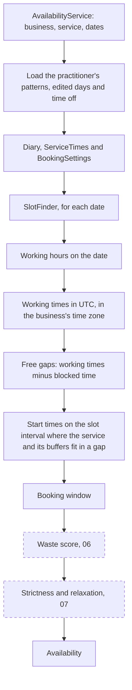

# 04 — Availability engine

## Goal

Work out which start times a practitioner can offer for a service over a range of dates, from their working hours, time off and booking settings. Times are correct across clock changes and in any time zone, and the engine is plain PHP that's tested hard: example tests, randomised rule checks over hundreds of generated diaries, and mutation testing with Infection on every pull request. This plan also sets the shape that bookings (05), the waste score (06) and strictness (07) build on.

## Depends on

03 (core data model): the tables, the tenancy scope, the hours value objects in `app/Scheduling/Hours`, the `AsUtcDateTime` cast and the sample business. 02 (CI and deployment): the `checks` job that Infection joins.

## Scope

**In scope**
- The engine in `app/Scheduling`: working times in UTC, free gaps, start times and the booking window
- What happens to working hours and start times when the clocks change
- `AvailabilityService`, which loads one business's practitioner, hours and time off for a range of dates and runs the engine
- An `availability:show` Artisan command that prints a day's times, so the engine can be tried before the playground
- Example unit tests, randomised rule checks and feature tests
- Mutation testing: Infection, PCOV (the coverage driver it needs) and a `Scheduling` test suite, run by `composer ci:check` and so on every pull request
- Updates to the overview and `tracking.md`

**Out of scope**
- Bookings (05). The engine takes blocked times of any kind, and 05 adds bookings to what `AvailabilityService` loads
- The waste score (06), strictness and the relaxation window (07), and strictness by time of day (later; see the overview, 5.4)
- Anything that combines practitioners, such as "anyone available" (after v1)
- HTTP endpoints and pages (08 and 11)
- Caching slots. They're always worked out from current data
- Logging searches (11)

## Decisions

The user's answers to this plan's questions (2026-11-02):

| Question | Answer |
|---|---|
| How far ahead customers can book | In whole days. With the default of 90, customers can book on dates up to 90 days after today, in the business's time zone. A new day opens at midnight, so the last day is either fully open or not shown |
| How mutation testing runs | On every pull request, through `composer ci:check` in CI's `checks` job. It fails below a mutation score of 90%, which can be raised once real scores are known |
| A command to try the engine | Yes: `availability:show` prints a day's working hours, free gaps and offered times for a business and service |

Settled while reviewing 03 (2026-11-02): the engine works on one practitioner, which the code that loads its data gets with `sole()`. Nothing in v1 combines practitioners.

## Design

### How slots are worked out



The dashed steps come in 06 and 07. In 04, the booking window is the last step.

For each date in the range, the engine:
1. Gets the practitioner's working hours from `WorkingHours::on()` (03): the edited day's hours if there is one, otherwise the pattern's.
2. Turns each local range into two instants in UTC, using the business's time zone and the clock-change rule below. These are the day's **working times**.
3. Subtracts **blocked time** (time off now, and bookings with their buffers from 05) to get the day's **free gaps**.
4. Lists every start time on the slot interval where the service, with its buffers before and after, fits inside one free gap.
5. Keeps the start times inside the booking window.

### The engine and its data

The engine is plain PHP that's handed everything it needs as value objects. `AvailabilityService` is the only part that reads the database.

| Option | Trade-off |
|---|---|
| **The engine is given value objects, built by a service that loads them (chosen)** | The engine is a pure calculation, with no database, clock or framework. The randomised checks can run hundreds of diaries in seconds, and Infection runs its tests once for every change it makes. Loading has to happen in one place, which suits the query count anyway |
| The engine queries a repository interface | It can fetch only what it needs, but tests need a fake repository, and the engine's reads are spread through it rather than done up front |
| The engine uses Eloquent directly | The least code, but every engine test needs the database, which would make mutation testing far too slow to run on each pull request |

**The engine reads no clock.** The current time is passed in, like everything else, so a test can say exactly when "now" is. `AvailabilityService` passes Laravel's `now()`, so feature tests use `travelTo()`.

**The steps are fixed and named, not a pluggable list.** There are only a few, their order matters, and 06 and 07 each add one in a known place. An interface that any number of filters plug into would add a layer of indirection for no gain.

### Clock changes

Working hours are local clock times. On the two days a year when the clocks change, some clock times are skipped and others happen twice. The engine reads every local time on a date as **the first moment that day when the clock shows that time or later**:
- **A skipped time** means the moment the clocks change. When London's clocks go forward, 01:30 means 02:00 BST (01:00 UTC). So working hours cover only the clock times that actually happen.
- **A repeated time** means its first occurrence. When the clocks go back, 01:30 means 01:30 BST.
- **24:00** means the first moment of the next day.
- **A range wholly inside a skipped hour** (01:00–01:45 on the night the clocks go forward) has no time in it, and is dropped.
- **Ranges the skipped hour brings together become one.** With hours of 00:00–01:15 and 01:30–03:00 on the night the clocks go forward, both ends meet at the moment of the change, so the practitioner works without a break in real time. Joining them keeps working times apart from each other, which the free gaps and the randomised checks rely on. (Settled while building.)

Start times follow the same rule, so a skipped clock time is never offered, and a repeated one is offered once. Lengths, buffers and minimum notice are real minutes. So a 60-minute appointment from 00:30 on the night the clocks go forward ends at 02:30 BST.

**PHP doesn't follow this rule, and it isn't even consistent.** Checked locally on PHP 8.5.4 and Carbon 3.15.1:
- A skipped time moves forward by the size of the jump, so 01:30 becomes 02:30 BST. Hours ending at 01:30 would gain 30 minutes the practitioner never listed, and hours starting at 01:30 would lose 30 minutes that do happen.
- For a repeated time, `CarbonImmutable::create()`, `parse()` and `createFromFormat()` give the second occurrence (01:30 GMT). But `setTime()` on a date already in that time zone gives the first (01:30 BST).

So `LocalClock` works out the rule itself from the time zone's transitions (`DateTimeZone::getTransitions()`), and its tests pin down each case. The rule isn't left to whichever PHP method the code happens to use. It only accepts named zones, such as `Europe/London`: abbreviations such as `BST` and fixed offsets such as `+05:45` have no transitions (checked: `getTransitions()` returns `false` for them), and a business's time zone is always a named one. Two alternatives were rejected:
- **PHP's default:** it changes the hours as described above, and two methods give two answers.
- **Refusing hours that touch a clock change:** a pattern is set once, and the date of the change moves every year.

Few businesses work at 1am. But some time zones change at midnight (Chile skips 00:00 to 01:00), and some by 30 minutes (Lord Howe Island). The randomised checks use those zones, so the rule has to be exact.

### Start times

- **On the clock, in the business's time zone.** A start time is a local clock time that's a whole number of slot intervals after midnight: with 15 minutes, :00, :15, :30 and :45. In Kathmandu (UTC+5:45), that's still :00 local, which is :15 UTC. Start times are listed by local clock time and then converted, rather than stepped through in UTC, so a 30-minute clock change can't knock them off the grid.
- **Inside one free gap, with the buffers.** A start time `s` is offered when the whole stretch from `s` minus the buffer before to `s` plus the length plus the buffer after lies inside one free gap. Buffers stay inside working hours, as 03 decided, so they can't run into a lunch break.
- **Half-open ranges.** Every range includes its start but not its end, so a booking ending at 10:00 and one starting at 10:00 don't overlap. That's also how PostgreSQL's time ranges work by default (`[)`), which 05's exclusion constraint uses.
- **A slot belongs to the date it starts on.** Working hours can't run past midnight (03), so a slot never spans two dates.

### Booking window

- **Minimum notice:** a start time must be at least the notice after now. Exactly the notice is allowed. It's measured in real minutes, so 2 hours' notice on the day the clocks change is still 2 hours.
- **Maximum advance, in whole days** (the user's answer): the last bookable date is today plus the maximum, counted in calendar dates in the business's time zone. With 90, a customer can book any time on the 90th date after today. That date opens at midnight.
- Both are worked out from the `now` the engine is given, in the business's time zone. Dates before today have no slots.

The window only filters start times. Each day still has its working times and free gaps, so the playground (08) can draw any date's timeline.

### Ready for 05 to 07

- **05:** bookings become blocked times, from start minus the buffer before to end plus the buffer after. `AvailabilityService` loads them beside time off, and the engine doesn't change. 05's booking action checks again with the same service, inside its transaction: it works out that day's slots and checks the requested start time is one of them.
- **06:** each slot carries the free gap it's in, and each day carries all its free gaps, including those too short for the service. Those are what the waste score and a day's stranded and fragmented time need. 06 adds the lengths of every service the practitioner offers, which in v1 are all the active services.
- **07:** strictness is a new step after the booking window. It asks what strictness applies at each time (overview, 5.4), and its rule that every free gap with room still offers a time can check each slot's gap.

## Data model

No changes. `AvailabilityService`'s queries use 03's indexes: `(business_id, practitioner_id)` on patterns and edited days, the unique `(practitioner_id, date)` on edited days, and `(business_id, practitioner_id, starts_at)` on time off.

## Backend

### The engine (`app/Scheduling`)

Plain PHP, as 03's `Hours` classes are: `final readonly` value objects, no Eloquent, no database, no clock, and `InvalidArgumentException` for invalid input. Instants are `CarbonImmutable` in UTC. Dates are passed as `CarbonInterface`, of which only the calendar date is read (as in 03), and results name dates as `Y-m-d` strings.

| Class | Holds | Main methods |
|---|---|---|
| `TimeRange` | two instants in UTC, start before end, half-open | `overlaps(TimeRange)`, `contains(TimeRange)` |
| `DateRange` | a first and last date, inclusive, 1 to 366 dates | `between(CarbonInterface $from, CarbonInterface $to)`, `dates(): list<string>` |
| `LocalClock` | a named time zone | `day($date): TimeRange` (the date's first moment to the next date's), `workingTimes($date, DayHours): list<TimeRange>`, `startTimeOn($date, int $minuteOfDay): ?CarbonImmutable` (null when the clocks skip it), `startTimesOn($date, int $intervalMinutes): list<CarbonImmutable>` (every start time on the interval, as `startTimeOn()` gives them), `dateOf(CarbonInterface $instant): string` |
| `Diary` | one practitioner's `WorkingHours` and `list<TimeRange>` of blocked time | — |
| `ServiceTimes` | `durationMinutes`, `bufferBeforeMinutes` and `bufferAfterMinutes`, named after the service's columns | — |
| `BookingSettings` | the business's time zone (`DateTimeZone`), slot interval, minimum notice in minutes and maximum advance in days | — |
| `BookingWindow` | `BookingSettings` and now | `earliestStart(): CarbonImmutable`, `lastDate(): string`, `allows(CarbonImmutable $startsAt): bool` |
| `FreeGaps` | — | `between(list<TimeRange> $workingTimes, list<TimeRange> $blockedTimes): list<TimeRange>` (static) |
| `Slot` | `startsAt`, `endsAt`, `blockedFrom`, `blockedUntil`, and `gap`, the free gap it's in | — |
| `DayAvailability` | `date`, `workingTimes`, `freeGaps` and `slots`, each list in time order | — |
| `Availability` | `list<DayAvailability>`, one for each date in the range, in order | `day(string $date): ?DayAvailability` |
| `SlotFinder` | — | `find(...)`, below |

The value objects check what they hold:
- `ServiceTimes`: a length above 0 and buffers of 0 or more.
- `BookingSettings`: a slot interval of 10, 15, 20, 30 or 60, notice of 0 or more, and a maximum advance of 1 or more. The database checks these too (03), and also caps the notice at 30 days and the advance at 365, with the notice shorter than the advance. The engine works for any larger values, so it doesn't refuse them, and the randomised checks try some.
- `DateRange`: refuses a last date before the first, or more than 366 dates. 366 covers the longest booking window (365 days) plus today.

The engine's entry point, which 05 to 07 build on:

```php
final readonly class SlotFinder
{
    public function find(
        Diary $diary,
        ServiceTimes $service,
        BookingSettings $settings,
        DateRange $dates,
        CarbonInterface $now,
    ): Availability
}
```

`FreeGaps::between()` copes with blocked times that overlap each other, start before or end after the working times, cover a whole day, or span several days. Each free gap is as long as it can be, and any part with no time in it is dropped. Free gaps are worked out per date, so two days' working times that meet at midnight never join into one gap.

**`SlotFinder` checks start times in whole seconds.** A day has up to 144 start times, and building Carbon objects for each one that's then thrown away took most of the engine's time (measured: the randomised checks' 300 scenarios took 2.3s in the engine, and 0.8s this way). It makes Carbon objects only for the slots it keeps. A free gap's ends are rounded inwards to whole seconds (`ceilSecond()` and `floorSecond()`), so blocked time ending part-way through a second still blocks that second; a start time is always a whole minute.

### `AvailabilityService` (`app/Services`)

```php
class AvailabilityService
{
    public function __construct(
        private CurrentBusiness $currentBusiness,
        private SlotFinder $slotFinder,
    ) {}

    public function forService(Business $business, Service $service, CarbonInterface $from, CarbonInterface $to): Availability
}
```

It:
1. **Checks its inputs:**
   - It throws `LogicException` if the current business isn't `$business`, through `CurrentBusiness::ensureIs()`, where 05 moved the check so `CreateBooking` can make it before locking. Entry points set the current business (03), and this makes a mismatch a clear error rather than an empty result. With no current business at all, `CurrentBusiness::get()` already throws `MissingCurrentBusiness`.
   - It throws `InvalidArgumentException` if the service belongs to another business.
   - It throws a new `App\Exceptions\ServiceNotBookable` (a `RuntimeException`) if the service is inactive. That's the rule 03 left to 04. 05's booking action lets it through, so `booking:create` and 11's pages can catch this one case, such as a service switched off while a customer was choosing a time.
   - Messages mention IDs, never names.
2. **Builds the `DateRange`** before querying anything, so an invalid range fails without touching the database.
3. **Loads, in four queries whatever the range:**
   - the practitioner, with `$business->practitioners()->sole()`
   - the patterns in force during the range (`starts_on` on or before the last date, and `ends_on` empty or on or after the first)
   - the edited days in the range
   - the time off overlapping the range: from the start of the first date to the end of the last, in the business's time zone, queried as UTC times. They're bound with their offset (`Y-m-d H:i:sP`, as `AsUtcDateTime` writes), because Laravel binds a Carbon without one, which would make the query depend on the connection's time zone (found in review; a test changes the session's zone). Only the start and end are read. The reason never reaches the engine
4. **Builds the value objects:**
   - `WorkingHours`, from `WorkingPattern::toRepeatingPattern()` and the edited days' hours
   - the `Diary`, with the time off as blocked times
   - `ServiceTimes` from the service
   - `BookingSettings` from the business
5. **Calls `SlotFinder::find()`** with `now()`, which is a `CarbonImmutable` because `AppServiceProvider` calls `Date::use(CarbonImmutable::class)`.

It isn't bound as a singleton. `CurrentBusiness` is scoped to one request or job (03), and a singleton would keep the first one it was given.

A business with no practitioner is a bug, since sign-up and sandboxes always create one, so the exception from `sole()` is left to surface rather than turned into an empty result.

### `availability:show` (`app/Console/Commands/ShowAvailability.php`)

```php
#[Signature('availability:show
    {business : The business ID}
    {service? : The service ID. Leave it out to list the business\'s services}
    {--date= : The date, as YYYY-MM-DD. Defaults to today in the business\'s time zone}')]
#[Description('Show the times the engine offers for a service on a date')]
class ShowAvailability extends Command
```

Laravel 13 declares a command's signature and description with these attributes (checked in the docs). The command:
- Finds the business, then works inside `CurrentBusiness::run($business, ...)`, since the console has no current business.
- With no service given, lists the business's services: ID, name, length, buffers and whether each is active.
- With a service, prints:
  - the business and the service
  - the date and the time zone
  - the working hours, the free gaps, and the offered times with a count
  - all in the business's local time, such as `09:00–13:00`
- Fails with a clear message and exit code 1 for:
  - an unknown business
  - a service that isn't the business's (the tenant scope means it isn't found)
  - an inactive service
  - a date that isn't `YYYY-MM-DD`

It uses real time, so times today inside the minimum notice aren't shown. It prints no customer details or time off reasons, so it's safe to run in production over `fly ssh console` when debugging.

After `php artisan migrate:fresh --seed`, `php artisan availability:show 1` lists the sample business's three services.

### Mutation testing

**What Infection does.** It makes small changes to the engine's code (flips a `<` to `<=`, removes a line, and so on), runs the tests that cover that code, and expects a test to fail each time. A change that no test catches "escapes", and shows a gap in the tests. The score is the share of changes caught.

**Checked locally in a throwaway PHP 8.5 container:**
- Infection 0.35.8, the latest when planned, installs beside PHPUnit 13.4 and runs with it, using PCOV 1.0.12. This is the check that the overview's testing section asked for. The build installed 0.35.9, the latest by then.
- It exits with code 1 when the score is below the minimum, so CI fails.
- It honours `testFrameworkExtraArgs: "--testsuite=Scheduling"`. The older `testFrameworkOptions` setting is deprecated.

**Setup:**
1. **Install** `infection/infection` as a development dependency (approved on 2026-10-27). Set `allow-plugins` for `infection/extension-installer` to `false`: the project uses no Infection extensions, so no plugin code needs to run during Composer installs.
2. **`phpunit.xml`:**
   - The `Unit` suite leaves out `tests/Unit/Scheduling`.
   - A new `Scheduling` suite runs `tests/Unit/Scheduling`.
   - `php artisan test` still runs every suite.
   - Checked locally: putting a folder in two suites makes PHPUnit 13 warn and run its tests once, so the folder must be left out of `Unit`.
3. **`infection.json5`** at the root:

   ```json5
   {
       "$schema": "vendor/infection/infection/resources/schema.json",
       "source": { "directories": ["app/Scheduling"] },
       "testFrameworkExtraArgs": "--testsuite=Scheduling",
       "mutators": { "@default": true },
       "minMsi": 90,
   }
   ```

   `minMsi` counts changes in untested code as escaped, so it's the stricter of Infection's two scores.
4. **`composer.json`:**
   - A `test:mutation` script sets `PAO_DISABLE=1` (`@putenv`), then runs `infection --threads=max --show-mutations=max`.
   - `ci:check` runs it after `@test`, so CI runs it on every pull request and `composer ci:check` runs it locally.
   - On GitHub Actions, Infection also shows escaped changes as annotations on the pull request.
   - **Why `PAO_DISABLE`** (found while building): under an AI agent such as Claude Code or Cursor, the `laravel/pao` development package turns PHPUnit's output into JSON. Infection reads PHPUnit's output to tell whether a test failed, so it counted every change as caught: the first run scored 100% when 14 changes had escaped. CI has no agent, so it was never fooled, but a run in an agent's terminal was. Turning pao off for Infection's runs alone keeps its output for everything else.
5. **PCOV in three places:**
   - The `dev` stage of the `Dockerfile` installs it with `install-php-extensions pcov`, as root. The production image doesn't get it.
   - CI's `checks` job sets `coverage: pcov` in `setup-php`.
   - Ubuntu needs `sudo apt install php8.5-pcov`, version 1.0.12 from Ubuntu's own packages (checked), as the PHP in Ubuntu comes from Ubuntu (decided 2026-10-27). The user runs this, since it needs `sudo`.

**If a change escapes,** add a test that catches it. Only a change shown to make no difference to behaviour (an "equivalent mutant") may be ignored, in `infection.json5`, with a comment saying why. That's in the same spirit as fixing the cause of every Larastan error.

**What the build found.** 14 of the first 410 changes escaped:
- Gaps in the tests, now covered: blocked time ending exactly at the end of the hours, a range in 03's `DayHours` with only one time that isn't a string, writing a time late in an hour (19:45), and the full message for a week with the wrong keys.
- Code that made no difference, now gone: `RepeatingPattern` subtracted the weekday before dividing by 7, which changes nothing because the cycle starts on a Monday, and it divided by a bare 86400 (now a named constant, as `DateRange` has). `SlotFinder`'s rounding is now `ceilSecond()` and `floorSecond()`, and `LocalTimeRange::parse()` reads named groups.
- The one ignore in `infection.json5`: the int casts in `LocalTimeRange::parse()`. The regex has already checked both parts are two digits, and PHP gives the same int without the casts.

All 389 changes are now caught, one of them (a loop that never ends) by timing out.

**Measure the run time once it's built.** If Infection takes more than about 3 minutes in CI, mark the randomised checks `#[Group('randomised')]` and leave them out of Infection's runs with `--exclude-group=randomised`. The example tests must then reach 90% on their own. Measured: 17s locally on 31 threads, and 52s in CI on 3, well under the limit.

## Frontend

None.

## Tests

**Engine tests extend `PHPUnit\Framework\TestCase`,** not the app's `Tests\TestCase`. The engine never touches Laravel, and booting the app for each test would slow every Infection run. 03's hours tests do the same. The method names start with `test_`, as in the rest of the suite. The engine's test files mirror `app/Scheduling` under `tests/Unit/Scheduling/`.

**Unit: value objects**
- `TimeRange`:
  - refuses an end at or before its start, and stores instants in UTC whatever zone they were given in
  - ranges that touch don't overlap
  - containment includes a range with the same start and end
- `DateRange` refuses a last date before the first, and 367 dates. It lists each date once, including across a clock change.
- `ServiceTimes` and `BookingSettings` refuse values outside their rules.

**Unit: `LocalClock`**
- **Normal days:** `workingTimes()` turns local hours into the right instants in London, in summer and in winter.
- **London, clocks going forward:**
  - hours that start or end in the skipped hour are clamped to the moment of the change
  - a range wholly inside it is dropped
  - hours either side of it are unaffected
  - `startTimeOn()` gives null for 01:15 and 01:30
- **London, clocks going back:**
  - a start or end in the repeated hour takes its first occurrence
  - a range across the whole night is 1 hour longer in real time
  - `startTimeOn()` gives the first 01:15 only
- **Chile, midnight skipped (`America/Santiago`, 2026-09-06):**
  - hours from 00:00 start at 01:00 local
  - `day()` starts at 01:00 local
  - 24:00 on the day before means that same moment
- **Lord Howe Island (`Australia/Lord_Howe`):** a 30-minute change skips exactly 02:00–02:29.
- **Kathmandu (`Asia/Kathmandu`, UTC+5:45):** 09:00 local is 03:15 UTC.
- **`dateOf()`:**
  - gives the business's local date, not the UTC date
  - a London evening in summer is still that date
  - an Auckland morning is a day ahead of UTC

**Unit: `FreeGaps`**
- No blocked time: the working times come back unchanged.
- Blocked time:
  - in the middle of a working time splits it in two
  - at either end trims it
  - covering it removes it
  - outside it changes nothing
- Overlapping and touching blocked times act as one.
- A blocked time across midnight affects both days' working times.

**Unit: `BookingWindow`**
- **Minimum notice:** a start exactly at now plus the notice is allowed, and one minute earlier isn't. With no notice, the earliest start is now.
- **The last date** is today plus the maximum advance, in the business's time zone. Any time on it is allowed, and the date after isn't.
- **Today follows the business's time zone,** so at 23:30 UTC, Auckland's today is the next date.

**Unit: `SlotFinder`, worked examples**
- **The overview's example (5.1):**
  - hours 09:00–12:00, a 30-minute blocked time at 10:00, a 60-minute service and a 15-minute interval
  - offers 09:00, 10:30, 10:45 and 11:00, and not 09:15
- **Buffers:**
  - with hours from 09:00 and 15 minutes before, the first time is 09:15
  - with 15 minutes after, the last time leaves the buffer inside the hours
  - a service can't use the lunch break for its buffer
  - back to back, a blocked time ending at 10:15 and a service with 15 minutes before give a first time of 10:30
- **Off the grid:** a gap starting at 10:07 offers 10:15 first with a 15-minute interval, and 10:10 with a 10-minute one.
- **Each slot interval** (10, 20, 30 and 60) offers times on its own grid.
- **No times, but the day is still there:**
  - with no pattern in force, or an edited day with no hours, the day has no working times, free gaps or slots
  - a service longer than every gap offers nothing, but the day keeps its free gaps
- **The booking window:**
  - today's times inside the minimum notice aren't offered
  - dates after the last date have no slots, but keep their working times and free gaps
  - past dates have no slots
- **Clock changes:**
  - a London 09:00–17:00 day either side of each change offers the same local times
  - a 60-minute slot from 00:30 on the night the clocks go forward ends at 02:30 BST
  - a repeated clock time is offered once
- **Each slot's fields:**
  - `endsAt` is the start plus the length
  - `blockedFrom` and `blockedUntil` add the buffers
  - `gap` is the free gap it sits in
- **The result:** one `DayAvailability` for each date in the range, in order.

**Unit: randomised rule checks** (`tests/Unit/Scheduling/SlotFinderRulesTest.php`)

A generator in `tests/Support/Scheduling/` builds random scenarios from a seed:
- **The time zone:** London, New York, Sydney, Auckland, Kolkata, Kathmandu, Lord Howe Island, Santiago or UTC.
- **The dates:** 1 to 21 of them, from 2026 to 2028. About a third start within a few days of a clock change in their zone.
- **Now:** anywhere from 3 days before the first date to the last date, so the booking window cuts some days.
- **The settings:**
  - any of the five slot intervals
  - minimum notice from 0 to 3 days, to the minute
  - maximum advance from 1 to 120 days
- **The service:** a length from 5 to 240 minutes and buffers from 0 to 60, in 5-minute steps.
- **Working hours:**
  - 0 to 3 patterns that don't overlap, each of 1 to 4 weeks
  - 0 to 3 ranges a day, in 5-minute steps, some starting at 00:00, some ending at 24:00, and some in the night hours when clocks change
  - 0 to 5 edited days, some with no hours
- **Blocked time:** 0 to 15 periods, to the minute. Some overlap, some span midnight or several days, and some start before the range or end after it.

The generator uses `Random\Randomizer` with a seeded `Random\Engine\Mt19937`, which touches no global state. Each scenario has its own engine, seeded from the seed and its number, so one can be recreated on its own. The seed and the number of scenarios are fixed (300 by default), and the `SCHEDULING_SEED` and `SCHEDULING_SCENARIOS` environment variables change them. A failure names the rule, the seed and the scenario number, and prints the scenario as JSON, so it can be turned into a worked example.

**Tuned while building, within the ranges above.** At first, only 2 slots in the default run fell within an hour of a clock change. So scenarios that start near a change lean their hours' ends towards 00:00, 24:00 and 22:00 to 05:00, and three quarters of them also edit the date of the change. Two thirds of scenarios look from before the first date, half have under 3 hours' notice, and 1 in 10 blocked times lasts more than 4 hours. The default run now has 36 slots within an hour of a change, and 192 of the 300 scenarios offer times.

Each rule is its own test method, run over every scenario. The rules are all checked in one pass over the scenarios, the first time a method asks, keeping only how many checks passed and each rule's first failure. Keeping every scenario's result for the other methods took 214MB, more than the container's 256MB allows once coverage is on. These rules always hold:
1. Each slot's fields agree: `endsAt` is the start plus the length, and `blockedFrom` and `blockedUntil` add the buffers.
2. Each slot, with its buffers, lies inside one of its day's working times and overlaps no blocked time.
3. Each slot starts on a clock time on the slot interval, in the business's time zone, on its day's date.
4. Each slot is inside the booking window.
5. **The slots are exactly the ones a brute-force check finds.** For each date, it tries every clock time on the interval, converted with `LocalClock::startTimeOn()`. It checks each time directly against the working times, the blocked times and the window, without free gaps. This catches times that are missed as well as times that shouldn't be there.
6. Each day's free gaps are exactly its working times minus blocked time. Each slot's gap is one of them and contains it, and every list is in time order with no duplicates.
7. There's one day for each date, in order.

Rule 5 uses `LocalClock`, which is why `LocalClock` has its own hand-written tests. 05 to 07 add their rules here, and the overview lists them.

**Feature: `AvailabilityService`** (`tests/Feature/Services/AvailabilityServiceTest.php`)

The sample business, at a fixed time with `travelTo()` (Monday 2 November 2026, 08:00 in London, the start of the pattern's week 1):
- **Physio assessment** (60 minutes, no buffers) on Monday 9 November: 09:00 to 12:00 and 14:00 to 16:30, every 15 minutes (24 times).
- **The same service on Tuesday 10 November:** only the morning, because of the time off from 14:00.
- **The same service on Wednesday 11 November:** the edited day's 10:00 to 15:00 (21 times).
- **Sports massage, 90 minutes** on 9 November: 09:00 to 11:30 and 14:00 to 16:00 (20 times).
- **Buffers,** which the sample business doesn't use: the same Monday with a service added for the test, of 90 minutes with 15 before and 15 after, offers 09:15 to 11:15 and 14:15 to 15:45.
- **On 2 November itself:** nothing before 10:00, because of the 2 hours' notice.

Other cases:
- **Loading:**
  - time off that starts before the range or ends after it still blocks the dates inside it
  - a pattern that ends or starts partway through the range is used only for its own dates
- **Query count:** the number of queries is the same for 1 date and for 60 (four).
- **Isolation:** another business's time off at the same times doesn't change this business's slots.
- **Refusals:**
  - it throws `ServiceNotBookable` for an inactive service
  - it throws `InvalidArgumentException` for another business's service (loaded without the scope for the test)
  - it throws `LogicException` when the current business is a different one, and `MissingCurrentBusiness` when there's none
  - an invalid date range throws before any query runs
- **Time:** `travelTo()` moves which of today's times are inside the minimum notice.

**Feature: `availability:show`** (`tests/Feature/Console/Commands/ShowAvailabilityTest.php`)
- With the sample business at the fixed time above, it prints Monday 9 November's working hours, free gaps and the 24 times for the physio assessment.
- With no service, it lists the three services.
- Each failure case gives its message and exit code 1:
  - an unknown business
  - another business's service
  - an inactive service
  - a badly formed date

**Mutation testing**
- `composer test:mutation` scores 90% or more on `app/Scheduling`, including 03's `Hours` classes, locally and in CI.

## Done when

- [x] Every test above passes in CI on PostgreSQL 18, with Pint and Larastan at level 9 clean
- [x] `composer test:mutation` scores at least 90% in CI, run through `composer ci:check`
- [x] The randomised checks pass with the default seed, and with at least five other seeds run locally (`SCHEDULING_SEED`)
- [x] `php artisan availability:show 1 <service> --date=<a weekday next week>` prints the sample business's times locally
- [x] PCOV is in the `dev` image and CI, and not in the production image (`docker run --rm <production image> php -m` doesn't list it)
- [x] `tracking.md` marks 04 as done, with Infection's run time and score, and PCOV in the development environment list

## Notes

**Personal data.** The engine sees only times. `AvailabilityService` reads time off's start and end but not its reason, and the command prints no names beyond the business's and the service's.

**Speed.** A month is four queries and a few thousand checks for one practitioner. Slots aren't cached (overview, 5.1). If 11's calendar ever needs it, cache the loaded `Diary` per request before caching slots.

**Exploring further.** CI always runs the same scenarios. To look for new edge cases, run the randomised checks locally with other seeds and more scenarios, for example `SCHEDULING_SEED=7 SCHEDULING_SCENARIOS=5000 php artisan test --filter=SlotFinderRulesTest`. Turn any failure into a worked example.

**For later sub-plans**
- **05:**
  - `AvailabilityService` loads the practitioner's active bookings overlapping the range as blocked times, from `blocked_from` to `blocked_until`, binding the range with its offset as the time off query does
  - the booking action checks again inside its transaction, after locking the practitioner's row: it runs `forService()` for the booking's date and checks the requested start is one of the slots
  - it lets `ServiceNotBookable` through, for `booking:create` and 11's pages to catch
  - the randomised checks already treat blocked time generally, so bookings need no new rule
- **06:**
  - add the lengths of the services the practitioner offers (in v1, every active service) to what the engine is given
  - score each slot from its `gap`
  - work out a day's stranded and fragmented time from its `freeGaps`
  - `LocalClock::startTimesOn()` gives a date's start times on the slot interval, for `ServiceFit`
  - count in whole seconds, as `SlotFinder` does: each Carbon `addMinutes()` costs about 3µs (measured), which adds up over every slot, piece and kind of appointment
- **Every later plan:** run Infection through `composer test:mutation`, never `vendor/bin/infection` on its own. The script sets `PAO_DISABLE=1`, without which an AI agent's run reports every change as caught.
- **07:**
  - strictness is a step after the booking window, asking what strictness applies at each time
  - 07 decided that 05's check again applies strictness: only offered times can be booked
- **08:** the playground's timeline draws a day from its `workingTimes`, `freeGaps` and `slots`, for any date, since only slots are limited by the booking window.
- **10:** the time zone a business chooses must be a named zone, such as `Europe/London`, from `DateTimeZone::listIdentifiers()`. `LocalClock` refuses any other (an abbreviation or a fixed offset), so `AvailabilityService` would throw for that business
- **11:**
  - the public API asks for at most a month or so at a time; `DateRange` refuses anything over 366 dates
  - route model binding should only find active services, so `ServiceNotBookable` is the rare case of a service switched off mid-visit
- **With staff (after v1):**
  - "anyone available" runs `forService()`'s engine call for each practitioner and merges the results
  - per-practitioner booking windows, lengths and buffers are resolved into `BookingSettings` and `ServiceTimes` before the engine sees them, so the engine doesn't change
