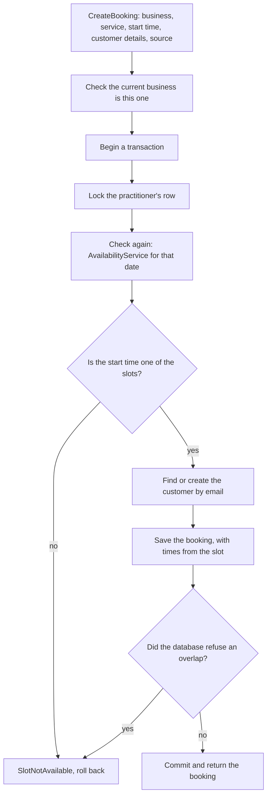
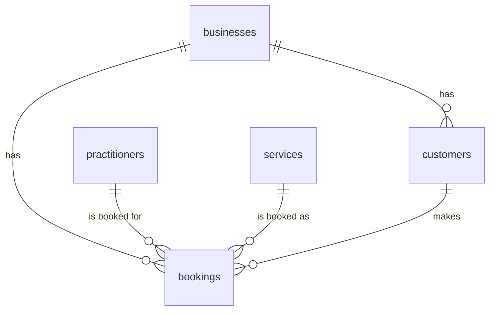

# 05 — Making bookings

## Goal

Let a booking be made safely: a `CreateBooking` action that checks the time with the engine, saves the customer and the booking, and can never double-book a practitioner, even when two customers press "book" at the same moment. Bookings then become blocked time, so the engine stops offering anything that would overlap them. There are no pages yet; the playground (08), the public booking page (11) and the admin calendar (13) call this action. Until then, a `booking:create` command books a time locally, so the engine can be tried around bookings of your own.

## Depends on

03 (core data model): businesses, practitioners, services, tenancy, the composite foreign keys and the `AsUtcDateTime` cast. 04 (availability engine): `AvailabilityService`, which this plan extends to load bookings and which the booking action uses to check the time.

## Scope

**In scope**
- `customers`: guests identified within a business by email, with no login
- `bookings`, with the exclusion constraint that refuses overlapping blocked time for one practitioner
- `CreateBooking`: lock, check again, save
- `AvailabilityService` loads bookings as blocked time
- Statuses and sources as enums, and the rule that a past confirmed booking counts as attended
- Factories, a few sample bookings for local development, and tests
- A `booking:create` command that books a time through `CreateBooking`, locally only, to try the engine before the playground
- Updates to the overview, 03, 04 and `tracking.md`

**Out of scope**
- Customer accounts and sign-in (guest booking only in v1; see the overview's open questions)
- Cancelling, moving and marking no-shows: the actions come with their first screens (12 and 13). The statuses and what they mean for the diary are set here
- The manage token for cancel and reschedule links (12, with the emails that carry them)
- Emails and events after a booking (12), and live updates (17)
- Pages, routes, Form Requests and rate limits (08, 11 and 13)
- Strictness when checking again (07, which decided that only offered times can be booked)
- Notes from customers. They could hold health details, and clinical records of any kind are out of scope

## Decisions

The user's answers to this plan's questions (2026-11-02):

| Question | Answer |
|---|---|
| Customer accounts | Guest booking only in v1: customers give their details and book, with no account. Customer accounts are a possible later feature, perhaps with a quick sign-up through Google. "Remember my details on this device" isn't wanted |
| Booking again with a known email | A booking never changes an existing customer's details. Each booking also records the name and phone given with it, so the owner can compare them with the customer's and update the customer if needed (13) |
| What customers must give | Name, email and phone, all required |
| A "completed" status | Not stored. The statuses are confirmed, cancelled and no-show. A confirmed booking whose end has passed counts as attended, unless the owner marks it as a no-show. Nothing runs on a timer, so the database can sleep, and the status can never be out of step |

Added after the plans were merged (2026-11-02), with the user's answers:

| Question | Answer |
|---|---|
| A way to make bookings by hand before the playground | Yes: a `booking:create` command books a time through `CreateBooking`. Then `availability:show` shows what changed, and from 06 and 07 the waste scores and hidden times too. Otherwise the only bookings before 08 are the seeder's three |
| Whether it runs in production | No. It writes bookings, and nothing can cancel one until 12 and 13, so it refuses to run in production. `availability:show` only reads, so it stays safe to run there |
| How to undo its bookings | Start again with `php artisan migrate:fresh --seed`. Cancelling stays with 12 and 13, which design the real cancel action |
| Booking a time that strictness hides | 07 gives it `availability:show`'s `--strictness=` option, which books as if the business were at that setting, without saving it |

Added before the build (2026-11-05), from checking the plan against 04's code, with the user's agreement:

| Question | Answer |
|---|---|
| Which date to check a start on | The start's date in the business's time zone. `CreateBooking` converts the start before calling `forService()`, which reads each date as it's given (04), so a start given in another zone could otherwise be checked against the wrong day |
| A current business that isn't the one booking | `CreateBooking` checks it before locking, with `CurrentBusiness::ensureIs()`, where 04's check moves so both share it. Otherwise the lock's query, which is scoped to the current business, finds no practitioner and throws `ModelNotFoundException`, a misleading error |
| The range the bookings query uses | Time off's, bound with its offset, so neither query depends on the connection's time zone (04's review) |

## Design

### Customers

A customer is someone who has booked with a business. They have no login, and they're identified within the business by email:
- **Emails are stored trimmed and in lower case,** so `Sam@Example.com ` and `sam@example.com` are the same customer. A check constraint keeps them lower case, and a unique index on `(business_id, email)` makes one customer per email per business. The same email at two businesses is two separate customers, who can't see each other (tenancy, 03).
- **The first booking sets the customer's name and phone.** Later bookings never change them, because anyone who knows a customer's email could otherwise change the details the owner sees. Each booking records the name and phone given with it (`customer_name` and `customer_phone`), so the owner sees both and can update the customer by hand (13).
- **Matching is silent.** Nothing tells the person booking that the email is already known, which would reveal that someone is a client of, say, a physio clinic.
- **Phone numbers are stored as given** (trimmed). Nothing matches on them, and 11's Form Request checks their format. Turning them into one standard format would need a phone number library, which can wait until something compares them.

### Statuses, and what counts as attended

| Status | Set by | Blocks time | Counts as attended |
|---|---|---|---|
| `confirmed` | Making the booking | Yes | Once its end has passed |
| `cancelled` | Cancelling (12 and 13) | No | No |
| `no_show` | The owner (13) | Yes | No |

A no-show still blocks its time, because that time was reserved and has passed anyway. Un-cancelling a booking is allowed only if its time is still free; the exclusion constraint refuses it otherwise.

"Attended" is worked out from the time, not stored, so nothing has to update bookings on a timer and the database can sleep (overview, section 8). A `Booking::attended($now)` query scope holds the rule for 13 and 14.

### Making a booking safely



Two layers stop a double booking (overview, 5.2):
1. **Lock, then check again.** The transaction locks the practitioner's row with `SELECT ... FOR UPDATE`, so two bookings for the same diary take turns. Then it runs the engine for that date and checks the start time is still offered. PostgreSQL's default isolation (read committed) means each query sees everything committed before it started, so once the lock is held, the engine sees the other booking. The customer who loses the race gets `SlotNotAvailable`, and the page shows "Sorry, that time was just taken" with the updated times (08 and 11).
2. **The database refuses overlaps.** An exclusion constraint refuses two bookings for one practitioner whose blocked times overlap, unless one is cancelled. It catches anything that skips the action, such as a bug or a direct `DB::table()` insert. When it fires inside `CreateBooking`, the error becomes `SlotNotAvailable` too.

**Checking again also enforces everything else the engine does:** a time not on the slot interval (09:07), outside working hours, during time off, inside the minimum notice or past the last bookable date is refused the same way. A customer who took too long and whose time is now inside the notice gets the same message.

**The booking's times come from the engine's slot,** not from the caller: `ends_at` is the start plus the service's length, and `blocked_from` and `blocked_until` add its buffers. They're stored, so changing a service's length or buffers later never moves an existing booking. The price is stored too (`price_pence`), so the booking keeps the price the customer was shown.

**Why lock the practitioner, rather than rely on the constraint alone?** Without the lock, the loser's insert fails at the constraint, which also works. But the lock makes the common case a clean check rather than a database error, and it's where later rules that the constraint can't express will live (07's strictness, if it's checked again). It costs one row lock for the length of a short transaction.

**No deadlocks.** The action takes one lock, always the practitioner's, so two bookings can't each hold a lock the other needs. The customer row is found or created after the lock. Bookings for the same business are serialised by the practitioner's lock in v1. When there are staff, `firstOrCreate()` handles two bookings creating the same customer at once: it looks for the customer first, and only when there's none inserts through `createOrFirst()`, which Laravel 13 runs in a savepoint inside the transaction and which fetches the existing row after a unique violation (both checked in its source).

### Personal data

A customer's name, email and phone are personal data:
- **Nightwatch** records each query's SQL with `?` placeholders, not the values (checked in its `QuerySensor`), and doesn't capture request bodies by default.
- **Error messages are the risk.** Checked locally: when a query fails, Laravel's `QueryException` message includes the values, so a failed insert into `customers` would put a name and email into Nightwatch and Fly's logs. Laravel 13 has a connection setting, `mask_bindings_in_exception_messages`, that leaves them out; with it on, the message shows only the placeholders (checked). 03 now turns it on in production.
- `SlotNotAvailable` and the other exceptions here mention IDs and times, never names, emails or phone numbers.
- Callers validate customer details before calling the action (11's and 13's Form Requests), so the database's own checks shouldn't fail on them.

### Ready for later sub-plans

- **07:**
  - strictness decides whether checking again refuses a time that still fits but that strictness would now hide
  - `booking:create` gains `availability:show`'s `--strictness=` option
- **08:** the playground calls `CreateBooking` with `BookingSource::Playground`, and its "Fill randomly" makes many bookings through it.
- **11:** the public booking page catches `SlotNotAvailable` and `ServiceNotBookable` and shows the customer a clear message with updated times.
- **12:**
  - adds the hashed manage token, created with the booking and sent in the confirmation email
  - adds the cancel action
  - dispatches the email after the transaction commits
- **13:**
  - the owner's own bookings, moving and cancelling them, and marking no-shows
  - whether the owner can book outside the offered times, such as inside the minimum notice. The constraint still stops overlaps whatever 13 decides
  - moving a booking checks again with the booking itself left out of the blocked time
  - editing customer details, and whether customers without an email (people who phone in) are allowed, which would make `email` nullable
  - tests that one owner's calendar never shows another business's bookings or customers, through the pages as well as the models

## Data model



Both tables have a `business_id` that references `businesses` with `ON DELETE CASCADE`, as 03's guard test requires, and both models use `BelongsToBusiness`.

**`customers`**

| Column | Type | Rules |
|---|---|---|
| `id` | bigint | primary key |
| `business_id` | bigint | |
| `name` | string(100) | as given with the first booking |
| `email` | string(254) | lower case and trimmed; check: `email = lower(email)` and not empty |
| `phone` | string(30) | as given with the first booking |
| timestamps | | |

Unique `(business_id, email)`, and unique `(business_id, id)` for bookings' composite foreign key to reference.

**`bookings`**

| Column | Type | Rules |
|---|---|---|
| `id` | bigint | primary key |
| `business_id` | bigint | |
| `practitioner_id` | bigint | composite foreign key to `practitioners (business_id, id)`, `noActionOnDelete()` |
| `service_id` | bigint | composite foreign key to `services (business_id, id)`, `noActionOnDelete()` |
| `customer_id` | bigint | composite foreign key to `customers (business_id, id)`, `noActionOnDelete()` |
| `starts_at` | timestamptz | UTC |
| `ends_at` | timestamptz | UTC |
| `blocked_from` | timestamptz | UTC: the start minus the buffer before |
| `blocked_until` | timestamptz | UTC: the end plus the buffer after |
| `customer_name` | string(100) | as given with this booking |
| `customer_phone` | string(30) | as given with this booking |
| `price_pence` | integer | the service's price when booked; check: 0 or more |
| `status` | string(20) | default `confirmed`; check: `confirmed`, `cancelled` or `no_show` |
| `source` | string(20) | check: `playground`, `booking_page`, `widget` or `admin` |
| timestamps | | |

Checks: `starts_at < ends_at`, `blocked_from <= starts_at` and `blocked_until >= ends_at`.

Exclusion constraint, written with `DB::statement` as 03's is:

```sql
alter table bookings add constraint bookings_no_overlap
    exclude using gist (practitioner_id with =, tstzrange(blocked_from, blocked_until, '[)') with &&)
    where (status <> 'cancelled')
```

`'[)'` includes each range's start but not its end, so a booking blocked until 11:15 and one blocked from 11:15 don't overlap, matching the engine's `TimeRange` (04). It needs `btree_gist`, which 03's first migration enables.

Indexes: `(business_id, customer_id)` and `(business_id, service_id)`, so a customer's or a service's bookings are quick to find and the foreign keys' checks on delete don't scan the table. The exclusion constraint's own index serves loading a practitioner's bookings for a range, as long as the query uses the same range expression and status condition (checked with `EXPLAIN`).

**The foreign keys use NO ACTION** (03's note): a practitioner, service or customer with bookings can't be deleted directly. A service is deactivated instead, and deleting a business still removes everything, because NO ACTION waits until the end of the delete.

**Checked locally on PostgreSQL 18,** in a throwaway database with these tables:
- the constraint refuses overlapping blocked time, with SQLSTATE `23P01`, and allows touching times
- cancelled bookings don't block, and un-cancelling one into an overlap is refused
- no-shows still block
- another business's bookings at the same times are allowed
- the composite foreign key refuses another business's customer
- a customer with bookings can't be deleted
- the lower-case check refuses `Sam@Example.com`
- deleting a business removes its customers and bookings and leaves another business's alone

The migrations' `down()` drops `bookings` and then `customers`.

## Backend

### Enums (`app/Enums`)

A new `app/Enums` folder. `php artisan make:enum` puts enums there once the folder exists (checked in its source), so create the folder first. TitleCase cases with string values:
- `BookingStatus`: `Confirmed = 'confirmed'`, `Cancelled = 'cancelled'`, `NoShow = 'no_show'`
- `BookingSource`: `Playground = 'playground'`, `BookingPage = 'booking_page'`, `Widget = 'widget'`, `Admin = 'admin'`

### Models

`Customer` and `Booking`, following 03's models: `#[Fillable]` with no foreign keys in it, `@property` docblocks, typed relations, a factory and `BelongsToBusiness`. As in 03, `business_id` and the other foreign keys aren't fillable, so code sets them through relations, and a request field can never move a row to another business.
- `Customer`: `business`, `bookings`.
- `Business` gains `customers` (has many), for `CreateBooking`'s `firstOrCreate()`.
- `Booking`:
  - relations: `business`, `practitioner`, `service`, `customer`
  - casts: the four instants with `AsUtcDateTime`, `status` as `BookingStatus` and `source` as `BookingSource`
  - scopes, with `#[Scope]` (Laravel 13's way, checked in the docs): `active()`, which leaves out cancelled bookings, and `attended(CarbonInterface $now)`, which keeps confirmed bookings whose end is at or before `$now`
- `Practitioner` gains `bookings` (has many).

### `App\Exceptions\SlotNotAvailable`

A `RuntimeException` for a start time that can't be booked, whatever the reason. Its message is generic. Pages show the customer the same "Sorry, that time was just taken" either way.

### `CreateBooking` (`app/Actions`)

```php
class CreateBooking
{
    public function __construct(
        private CurrentBusiness $currentBusiness,
        private AvailabilityService $availability,
    ) {}

    /**
     * @param  array{name: string, email: string, phone: string}  $customer
     */
    public function handle(
        Business $business,
        Service $service,
        CarbonInterface $startsAt,
        array $customer,
        BookingSource $source,
    ): Booking
}
```

The customer details come as an array, as a Form Request's `validated()` gives them.

First it checks that the current business is `$business`, with `CurrentBusiness::ensureIs()`, which throws `LogicException` for another business and `MissingCurrentBusiness` for none. 04's `AvailabilityService` made this check itself; it moves to `CurrentBusiness` so both share it. It has to come before the lock: the lock's query is scoped to the current business, so with another one it would find no practitioner and throw `ModelNotFoundException`.

Then, inside one `DB::transaction()`:
1. Lock the practitioner: `$business->practitioners()->lockForUpdate()->sole()`.
2. Check again:
   - turn the start into the business's time zone and call `forService()` with it as both dates. `forService()` reads each date as it's given (04), so a start given in UTC or another zone could fall on a different date there
   - find the slot whose `startsAt` is the same instant as `$startsAt`, whatever zone the caller gave it in. None means `SlotNotAvailable`, and so does a start with seconds, which is never on the slot interval
   - `forService()` also refuses an inactive service (`ServiceNotBookable`) and another business's service (`InvalidArgumentException`). `CreateBooking` lets both through, for its callers to catch (`booking:create` here, and 11's pages)
3. Normalise the details: trim each one, and lower-case the email.
4. Find or create the customer with `$business->customers()->firstOrCreate(['email' => ...], ['name' => ..., 'phone' => ...])`. The relation sets `business_id`, which isn't fillable (03), and scopes the lookup to the business. An existing customer's details aren't changed. It's `firstOrCreate()` rather than `createOrFirst()`, which the plan first named, because `createOrFirst()` tries the insert first: every returning customer's booking would fail an insert, and PostgreSQL logs that failure with the email (found in the build's review, and seen in the local database's log). `firstOrCreate()` looks first, and falls back to `createOrFirst()` only for a new customer.
5. Create the booking, with:
   - `business_id` and the other foreign keys set through relations (`associate()`), as the customer's is, so both work with model events off, as in `DatabaseSeeder` (03 does the same in `CreateSampleBusiness`)
   - the slot's four instants
   - the service's price
   - the details as given
   - `status` confirmed, and the source
6. If saving fails with SQLSTATE `23P01` (`QueryException::getCode()` returns `'23P01'`, checked), throw `SlotNotAvailable` instead. Any other database error is left alone. Throwing inside the transaction rolls it back, so a refused booking leaves no customer behind.

It returns the booking. It dispatches nothing yet; 12 adds the confirmation email after the commit.

### `AvailabilityService` (04) loads bookings

A fifth query loads the practitioner's active bookings that overlap the range, reading only `blocked_from` and `blocked_until`:

```php
// $rangeStart and $rangeEnd: the start of the first date and the end of the last, as
// 'Y-m-d H:i:sP' strings with their offset, worked out once and shared with time off's query.
$practitioner->bookings()->active()
    ->whereRaw("tstzrange(blocked_from, blocked_until, '[)') && tstzrange(?, ?, '[)')", [$rangeStart, $rangeEnd])
```

The range is time off's, bound with its offset as 04 does, so the query doesn't depend on the connection's time zone: Laravel would bind a Carbon without one. The bookings join time off as the `Diary`'s blocked times. The engine doesn't change, and the randomised checks already cover blocked time of any kind. The query count stays the same for any range (now five).

`AvailabilityService`'s check that the current business is `$business` moves to `CurrentBusiness::ensureIs()`, so `CreateBooking` can make it too, with the same `LogicException`.

### `booking:create` (`app/Console/Commands/BookSlot.php`)

```php
#[Signature('booking:create
    {business : The business ID}
    {service : The service ID}
    {start : The start, as "YYYY-MM-DD HH:MM" in the business\'s time zone}
    {--name=Test Customer : The customer\'s name}
    {--email=test@example.com : The customer\'s email}
    {--phone=07700900000 : The customer\'s phone}')]
#[Description('Book a time through CreateBooking, to try the engine locally')]
class BookSlot extends Command
```

It's named `BookSlot` because `CreateBooking` is the action's name. It's the counterpart of 04's `availability:show`: book a time, then run `availability:show` for that date to see what changed. The command:
- **Refuses to run in production,** with a clear message and exit code 1, before touching the database. It writes bookings, and nothing can cancel one until 12 and 13. To undo bookings made locally, start again with `php artisan migrate:fresh --seed`.
- Finds the business, then works inside `CurrentBusiness::run($business, ...)`, as `availability:show` does. Both commands find their business and service through one trait, `App\Console\Commands\Concerns\FindsBusinessAndService`, with `availability:show`'s messages.
- Turns `start` into an instant with `LocalClock::startTimeOn()` (04), so it follows the engine's rule on the nights the clocks change: a repeated time means its first occurrence, where PHP's own parsing gives the second.
- Checks the customer options, as every caller of the action must (see Notes): each is required and within its column's length, and the email is a valid address.
- Calls `CreateBooking` with `BookingSource::Admin`, as the sample bookings do.
- Prints the booking's ID, the service, and its local date, start and end, with no customer details.
- Fails with a clear message and exit code 1, writing nothing, for:
  - an unknown business
  - a service that isn't the business's
  - an inactive service (`ServiceNotBookable`)
  - a start that isn't `YYYY-MM-DD HH:MM`, or a time the clocks skip
  - invalid customer options
  - a time that isn't offered (`SlotNotAvailable`), with a pointer to `availability:show`

The default customer is made up: `example.com` is reserved for examples, and Ofcom keeps 07700 900000 to 900999 for drama. Bookings made with the defaults all belong to one customer, since customers are matched by email.

### Sample bookings for local development

`DatabaseSeeder` makes three bookings in the sample business next week through `CreateBooking`, inside `CurrentBusiness::run()`. They use made-up customers at `example.com` (a domain reserved for examples) and `BookingSource::Admin`. So `availability:show` shows the engine working around real bookings. `CreateSampleBusiness` itself stays without bookings; whether a playground sandbox starts with some is 08's decision.

### Factories

- `CustomerFactory`: a name, a lower-case `safeEmail()` and a phone number, using Faker (factories are for tests and local development only).
- `BookingFactory`:
  - takes the practitioner, service and customer from one business, as 03's child factories do
  - by default starts at 10:00 local on the next weekday
  - works out `ends_at`, `blocked_from` and `blocked_until` from the service's length and buffers, copies its price, and fills the details as given from the customer
  - states: `at(CarbonInterface $startsAt)`, `cancelled()` and `noShow()`

Tests that create more than one booking choose times that don't overlap, or the constraint refuses them.

## Frontend

None.

## Tests

Feature tests on PostgreSQL. Names start with `test_`, and files mirror `app/`. 03's guard test covers both new tables once they're added to its list of known tenant tables, which it checks the tenant models against.

**Feature: tenancy** (`tests/Feature/Tenancy/`, beside 03's). A booking or customer from one business must never reach another business's diary, so with two businesses that have bookings and customers at the same times:
- `Customer` and `Booking` return only the current business's rows, through queries, relations and eager loading, including a booking's `customer` and a practitioner's `bookings`
- route model binding doesn't find another business's booking or customer
- with no current business, querying either throws `MissingCurrentBusiness`
- `CreateBooking` for one business never uses or changes another business's customer with the same email (in `CreateBookingTest`, beside the action's other tests)

**Feature: database rules** (`tests/Feature/Database/`)
- **Overlaps:**
  - overlapping blocked time for one practitioner is refused, including one booking's buffer overlapping another's appointment
  - blocked times that only touch are allowed
  - a cancelled booking doesn't block, and un-cancelling it into an overlap is refused
  - a no-show still blocks
  - another business's booking at the same times is allowed
- **Cross-business references:** the composite foreign keys refuse a booking whose practitioner, service or customer belongs to another business.
- **Deletes:**
  - deleting a practitioner, service or customer with bookings is refused
  - deleting the business removes its customers and bookings, and leaves another business's alone
- **Customers:** an email with capitals is refused, and so is a second customer with the same email in one business. The same email in two businesses is allowed.
- **Checks refuse:**
  - a booking that ends at or before its start
  - blocked time that doesn't cover the appointment
  - a negative price
  - an unknown status or source

**Feature: `CreateBooking`** (`tests/Feature/Actions/CreateBookingTest.php`)

With the sample business at a fixed time (`travelTo()`, as in 04):
- **Saving:**
  - booking a physio assessment at 10:00 on Monday 9 November saves the booking with `ends_at` 11:00, `blocked_from` 10:00 and `blocked_until` 11:00 (the sample business has no buffers), the service's price, status confirmed and the source
  - it creates the customer with the email in lower case
  - a start given in `Pacific/Kiritimati` (UTC+14), where 10:00 on Monday 9 November in London is already 10 November, books that time
- **A repeat email:**
  - a second booking with the same email, in a different case or with spaces, uses the same customer
  - the customer's name and phone don't change
  - the booking records the new name and phone
- **Back to back:** after that booking, a follow-up can start at 11:00, since bookings that only touch don't overlap.
- **Buffers,** with a service added for the test, of 30 minutes with 15 after: booked at 10:00, it's saved with `blocked_until` 10:45, and the next booking can start at 10:45 but not 10:30.
- **Refusals (`SlotNotAvailable`, with nothing written, not even a new customer):**
  - a time already taken
  - 09:07, which isn't on the slot interval
  - outside working hours
  - during time off
  - inside the minimum notice
  - after the last bookable date
- **Cancelling frees the time:** once the booking is cancelled (its status set directly), the same time can be booked again.
- **Other refusals:**
  - an inactive service throws `ServiceNotBookable`
  - another business's service throws `InvalidArgumentException`
  - with another business as the current one, it throws `LogicException`, with nothing written
  - with no current business, it throws `MissingCurrentBusiness`
- **Later changes don't move bookings:** changing the service's price, length or buffers afterwards doesn't change an existing booking.
- **When the database catches the race:** `AvailabilityService` is replaced in the container with one that still offers a taken time, as if the other booking landed after the check. The constraint refuses the booking, and the action throws `SlotNotAvailable`, not `QueryException`, with nothing written. This is the only way to reach that branch without two processes.

**Feature: the lock** (`tests/Feature/Actions/CreateBookingLockTest.php`)
- This test uses `DatabaseTruncation` rather than `RefreshDatabase`, so its rows are committed and a second connection can see them. The second connection is a copy of `pgsql` set up in the test.
- The second connection begins a transaction and locks the practitioner's row with `FOR SHARE`. With `lock_timeout` set to 500ms on the default connection, `CreateBooking` fails with SQLSTATE `55P03` (lock timeout), which shows it waits for the practitioner's lock.
- `FOR SHARE`, not `FOR UPDATE`, because saving the booking checks its foreign key to the practitioner, which takes `FOR KEY SHARE` on the same row. `FOR UPDATE` blocks that check too, so the test passed with `CreateBooking`'s lock removed (found while building). `FOR SHARE` blocks only `CreateBooking`'s own `FOR UPDATE`: without it, the booking is saved and the test fails.
- The test empties the tables again afterwards, as `DatabaseTruncation` only empties them before each test, so later tests don't see its committed rows.

**Feature: `AvailabilityService`**, adding to 04's tests:
- **Blocking:** a confirmed booking removes its blocked time, buffers included, from the free gaps; a cancelled one doesn't; a no-show does.
- **Range edges:** a booking that starts before the range or ends after it still blocks the dates inside it.
- **Isolation:** another business's booking at the same time changes nothing.
- **The connection's time zone:** with the session's time zone changed, a booking at the end of the range still blocks it, as 04's test checks for time off.
- **Query count:** the same for 1 date and 60 (five).

**Feature: `CurrentBusiness::ensureIs()`**, beside 03's `CurrentBusiness` tests: it passes for the current business, and throws `LogicException` for another business and `MissingCurrentBusiness` with none. 04's test that `AvailabilityService` refuses a business that isn't the current one still passes.

**Feature: `Booking::attended()`** keeps confirmed bookings that have ended, and leaves out future, cancelled and no-show bookings. A booking ending exactly at `$now` counts as attended.

**Feature: sample bookings**
- `php artisan db:seed` creates the three sample bookings.
- The sample business's availability on that day leaves them out.

**Feature: `booking:create`** (`tests/Feature/Console/Commands/BookSlotTest.php`), with the sample business at 04's fixed time:
- `booking:create <business's ID> <assessment's ID> "2026-11-09 10:00"` books it through `CreateBooking`, with `BookingSource::Admin` and the default customer, and prints its ID and `10:00–11:00`.
- Given `--name`, `--email` and `--phone`, it uses them.
- Each failure gives its message and exit code 1, with nothing written:
  - an unknown business
  - another business's service
  - an inactive service
  - a badly formed start
  - a time the clocks skip (`2027-03-28 01:30` in London)
  - an invalid email
  - a time already taken
- With the app's environment set to production, it refuses before reading the database.

## Done when

- [x] Every test above passes in CI on PostgreSQL 18, with Pint and Larastan at level 9 clean, and Infection still at 90% or more
- [x] `php artisan migrate:fresh --seed` creates the sample bookings, and `php artisan migrate:rollback --step=2` removes both tables without errors
- [x] `php artisan availability:show 1 <service> --date=<the sample bookings' date>` leaves out the booked times locally
- [x] `php artisan booking:create 1 <follow-up's ID> "<date> <a time availability:show offers>"` books it locally, and `availability:show` for that date then leaves it out
- [ ] The deploy after merging runs the new migrations on Neon (Fly's release command succeeds)
- [x] `tracking.md` marks 05 as done

## Notes

**Customers' personal data.** Name, email and phone are stored for each customer, and the name and phone given with each booking. Nothing else is asked for. Customers can't be deleted while they have bookings; deleting or anonymising a customer on request is for the admin screens (13 or later), and needs deciding with the owner's legal duties to keep records in mind.

**What's not checked again.** The action trusts its callers to have validated the customer's details (lengths, email format, phone format). A value the database refuses gives a `QueryException`, which production logs without the values.

**Locks and Neon.** Each booking holds one row lock for a few milliseconds. Nothing waits on a timer, so the database still sleeps when nobody's booking.

**Strictness and checking again.** 07 adds strictness to the engine and decided that the check applies it: only offered times can be booked, so a hidden time can't be booked by calling the API directly. `CreateBooking` already looks for the start among the day's `slots`, which strictness filters, so its code doesn't change. Once 07 sets a default strictness of 50, this plan's tests set the sample business's strictness to 0, since they test fitting and booking, not strictness (07).
