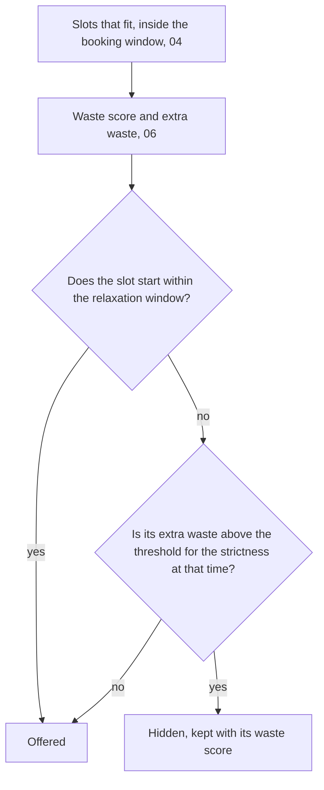

# 07 — Strictness and relaxation

## Goal

Let each business choose how tightly its diary is packed. A **strictness** setting from 0 to 100 hides the times that would waste the most room, using 06's extra waste. A **relaxation window** stops strictness applying close to each time, so room kept for a longer appointment isn't left empty when nobody is likely to book it. Hidden times are kept, with their scores, so the playground (08) can show what was hidden and why. Only offered times can be booked.

## Depends on

04 (availability engine), 05 (making bookings) and 06 (waste score): this plan adds the last step to the engine, after the booking window and the waste score, and settles 05's final check.

## Scope

**In scope**
- `strictness` and `relaxation_hours` on businesses, with defaults
- The strictness step in the engine: which times are hidden, and the hidden times kept for explanations
- The relaxation window
- `CreateBooking`'s final check applying strictness
- `availability:show` showing hidden times, with a way to try other strictness values
- Tests, and updates to the overview, 04, 05 and `tracking.md`

**Out of scope**
- Strictness by time of day, and fixed start times (later; overview, 5.4). This plan only gives the engine one place to ask what strictness applies at a time
- The settings screen and the live preview (10)
- Owner bookings that skip strictness (13)
- Relaxing gradually, or learning when to relax from history (19)

## Decisions

The user's answers to this plan's questions (2026-11-02):

| Question | Answer |
|---|---|
| How the relaxation window switches off strictness | All at once: from 48 hours before a time (by default), strictness stops applying to it, and every time that fits is offered. Simple to explain and to show in the playground |
| Whether the final check before saving applies strictness | Yes: a time can only be booked while it's offered. Otherwise a hidden time could be booked by calling the public booking API directly, getting round the owner's setting. If another booking hides a customer's time in the seconds before they confirm, they're told it has gone and shown the updated times |
| A new business's settings | Strictness 50 and a 48-hour relaxation window, to be tuned once the playground (08) shows them working |

## Design

### Where strictness fits



### Which times are hidden

A slot is hidden when all three are true:
1. the strictness at its start time is above 0
2. it starts after the relaxation window, that is, more than `relaxation_hours` after now
3. its extra waste is above the **threshold**: `120 × (100 − strictness) ÷ 100` minutes

The threshold falls steadily as strictness rises:
- **0 hides nothing.** Every time that fits is offered, as the overview defines it. The formula alone would give 120 minutes at 0, so 0 is the one special case.
- **50 hides times that waste more than 60 minutes more than the best time in their gap.**
- **100 hides everything above 0,** so only the best times in each gap stay.

The comparison uses whole numbers, `100 × extra > 120 × (100 − strictness)`, so a time exactly on the threshold is kept.

**Every free gap with room still offers a time.** The best time in each gap has extra waste 0, and 0 is never above any threshold. That's the overview's rule, held by the design rather than by extra code.

**The 120 minutes is a first version**, a named constant, like 06's. It was chosen from the sample business, so that 50 is a middle setting: the playground (08) will show whether it feels right. 80 minutes suited the original six-service sample (03's notes), but with three services and no buffers it hid more than half of some rows at 50. On an empty Monday, the sample business offers these numbers of times:

| Strictness | 0 | 25 | 50 | 60 | 70 | 75 | 80 | 90 | 95 | 100 |
|---|---|---|---|---|---|---|---|---|---|---|
| Follow-up, morning (15 that fit) | 15 | 15 | 15 | 13 | 12 | 8 | 8 | 6 | 6 | 2 |
| Follow-up, afternoon (13) | 13 | 13 | 11 | 7 | 5 | 5 | 4 | 2 | 2 | 2 |
| Assessment, morning (13) | 13 | 13 | 11 | 7 | 5 | 5 | 4 | 2 | 2 | 2 |
| Assessment, afternoon (11) | 11 | 11 | 11 | 11 | 9 | 6 | 6 | 6 | 6 | 2 |
| 90-minute massage, morning (11) | 11 | 11 | 11 | 11 | 9 | 6 | 6 | 6 | 6 | 2 |

These come from the throwaway prototype of 06's formula:
- **At 50,** only the worst times are hidden. On the morning, that's the assessment at 09:15 and 11:45, which strand 15 minutes and split the morning awkwardly. Nothing is hidden for the follow-up.
- **At 75,** about half remain.
- **From 90,** only the edges and the times that cost no room are left.
- **At 100,** every row keeps the two times at the edges of its gap.

| Option for turning strictness into hidden times | Trade-off |
|---|---|
| **A threshold in minutes of extra waste that falls in a straight line (chosen)** | Easy to explain: "at 50, times that waste more than 60 minutes more than the best are hidden". The same setting means the same thing on every day |
| A threshold that falls along a curve, `K × (100 − strictness) ÷ strictness` | No special case at 0, and finer control near the tight end, but much harder to explain |
| Hide a share of the times: the most wasteful half at 50 | Adapts to any business without a constant, but it hides harmless times when the scores barely differ, and a setting wouldn't mean the same minutes from one day to the next |

### The relaxation window

Strictness stops applying to a time once it's within `relaxation_hours` of now, all at once (the user's answer):
- A time starting exactly 48 hours from now is within the window.
- The hours are real hours, so the window is the same length across a clock change.
- `relaxation_hours` of 0 means strictness always applies.

**Why it exists** (`background.md`, sections 2 and 6): room kept for a longer appointment is only worth keeping while someone might still book it. Close to the date that's unlikely, so the time is released rather than left empty.

Whether a time is within the window depends on when someone looks. So the same time can be hidden on Monday and offered on Wednesday, and the playground's "how far ahead" control shows exactly that.

### What strictness applies at a time

`BookingSettings` (04) gains `strictness` and `relaxationHours`, and a method the strictness step calls for each slot:

```php
public function strictnessAt(CarbonImmutable $startsAt): int
```

In v1 it returns the business's strictness for every time. Strictness by time of day (overview, 5.4) is a later change to this one method and the data behind it, so the step itself doesn't change. There's no interface for it yet, since there's only one way to answer.

### Hidden times are kept

`DayAvailability` gains `hiddenSlots`: the slots strictness hid, each with its `WasteScore`. `slots` stays the times that are offered. So:
- the playground's "show hidden times" greys them out and explains them from their waste score (08)
- 10's preview counts both, as "18 times offered (32 at loosest)", from one call
- the public API (11) sends only `slots`

### The final check before saving

`CreateBooking` (05) already looks for the requested start among the day's `slots`. Once strictness filters `slots`, a hidden time is refused with `SlotNotAvailable`, as the user chose, and `CreateBooking`'s code doesn't change. Inside the relaxation window nothing is hidden, so a customer booking close to the date never sees this.

## Data model

**`businesses`** gains two columns:

| Column | Type | Rules |
|---|---|---|
| `strictness` | smallint | default 50; check: 0 to 100 |
| `relaxation_hours` | smallint | default 48; check: 0 to 720 (30 days) |

Existing businesses (sandboxes in production, by the time this deploys) get the defaults. The migration's `down()` drops both columns.

## Backend

### The engine (`app/Scheduling`)

- **`BookingSettings`:**
  - gains `strictness` (checked 0 to 100) and `relaxationHours` (checked 0 to 720)
  - gains `strictnessAt()`, above
- **`StrictnessFilter`:** a new step after `WasteScorer`, holding the constant `MAX_THRESHOLD_MINUTES = 120`. For each day, it splits the scored slots into offered and hidden, by the three rules above, using the `now` the engine is given.
- **`DayAvailability`** gains `hiddenSlots` (`list<Slot>`, in time order).
- **`SlotFinder::find()`** keeps its signature.

### `AvailabilityService` (04)

It builds `BookingSettings` with the business's strictness and relaxation window. The query count doesn't change, since the business is already loaded.

### `availability:show` (04 and 06)

- It lists the hidden times with their extra waste, beside the offered ones.
- It says whether the date is within the relaxation window.
- A new `--strictness=` option (0 to 100) shows the day at another strictness without changing the business, to try settings before the playground exists. The command sets the value on the business it has loaded, without saving it, and `AvailabilityService` reads it from there. An invalid value is refused with exit code 1, and a test checks the stored strictness is unchanged afterwards.

## Frontend

None.

## Tests

As in 04 and 06: engine tests extend `PHPUnit\Framework\TestCase`, method names start with `test_`, and files mirror `app/Scheduling` under `tests/Unit/Scheduling/`.

**Earlier tests that test fitting, not strictness.** With a default of 50, some of 04's, 05's and 06's sample-business tests would lose times they expect. For example, 04 expects 24 assessment times on Monday 9 November, and strictness 50 offers 22. Those tests set the business's strictness to 0, because they test what fits and what's booked, not what strictness hides. This plan's tests cover strictness itself.

**Unit: `BookingSettings`**
- It refuses strictness outside 0 to 100 and a relaxation window outside 0 to 720.
- `strictnessAt()` returns the business's strictness for any time.

**Unit: `StrictnessFilter`**
- **The sample morning:** the follow-up row of the table above, offered times at each strictness listed.
- **The threshold's edges:** at 50, a slot with extra waste 60 is offered and one with 61 is hidden.
- **The ends of the scale:** at 0, nothing is hidden, even with extra waste of 500; at 100, only slots with extra waste 0 stay.
- **The relaxation window:**
  - a slot starting exactly `relaxation_hours` after now is offered at 100
  - one a minute later is filtered
  - with `relaxation_hours` 0, every slot is filtered
  - across the night the clocks go forward, 48 hours means 48 real hours
- **Hidden slots:** `hiddenSlots` holds exactly the slots removed, in time order, each with its waste score.

**Unit: randomised rules**, added to `SlotFinderRulesTest`. The generator also picks a random strictness and relaxation window.
1. **Raising strictness only hides times.** For two random strictness values, the higher one's offered times are among the lower one's.
2. At strictness 0, nothing is hidden.
3. Each day's offered and hidden slots don't overlap, and together they're every slot that fits inside the booking window.
4. **Every free gap that offers a time at strictness 0 offers at least one at any strictness.**
5. **Within the relaxation window, strictness has no effect.** Slots starting within it are the same at every strictness.
6. Every hidden slot starts after the relaxation window and has extra waste above its threshold. Every offered slot after the window has extra waste at or below it.

These are the overview's last three rules (section 10), plus the checks that the step splits slots correctly.

**Feature: `AvailabilityService`**, with the sample business at 04's fixed time (Monday 2 November 2026, 08:00 in London):
- **At the default of 50,** Monday 9 November's assessment times are the 22 in the table: 11 in the morning and all 11 in the afternoon. 09:15 and 11:45 are in `hiddenSlots`.
- **At strictness 0,** all 24 are offered.
- **The relaxation window:** at Sunday 8 November, 12:00, Monday 9 November is within 48 hours, so all 24 are offered at 50.
- **Settings are read from the business:** changing its strictness or relaxation window changes the result.

**Feature: `CreateBooking`**, at 04's fixed time:
- At 50, booking the assessment at 09:15 on Monday 9 November, a hidden time, throws `SlotNotAvailable`, with nothing written.
- At Sunday 8 November, 12:00, inside the relaxation window, the same booking succeeds.

**Feature: database rules**
- New businesses get strictness 50 and a 48-hour relaxation window.
- Values outside the ranges are refused.

**Feature: `availability:show`**
- `--strictness=0` and `--strictness=100` change the times listed.
- Hidden times are listed with their extra waste.
- `--strictness=101` is refused.

**Mutation testing:** the new code is in `app/Scheduling`, so Infection covers it, and the score stays at 90% or more.

## Done when

- [ ] Every test above passes in CI on PostgreSQL 18, with Pint and Larastan at level 9 clean, and Infection at 90% or more
- [ ] `php artisan availability:show 1 <assessment's ID> --date=<a Monday at least 3 days ahead>` shows offered and hidden times locally, and `--strictness=0` shows them all
- [ ] The deploy after merging runs the migration on Neon (Fly's release command succeeds)
- [ ] `tracking.md` marks 07 as done, and with 03 to 06 done, the engine is complete for the playground (08)

## Notes

**A first version, to be tuned.** These are starting points, which the playground (08) will show working on the sample business:
- the default strictness (50)
- the default relaxation window (48 hours)
- the 120-minute scale

Learning from history (19) and the simulator (20) can later replace them with data. Gradual relaxation was considered and left for then.

**For later sub-plans**
- **08:**
  - the slider changes the sandbox business's strictness
  - "show hidden times" uses `hiddenSlots` and their waste scores
  - "how far ahead" shows the relaxation window at work
  - the defaults and the 120-minute scale get tuned here
- **10:**
  - the settings screen sets both values
  - its live preview should show a date beyond the relaxation window, such as a day next week. Tomorrow is inside the default 48 hours, so strictness doesn't change anything there
  - the preview counts `slots` against `slots` plus `hiddenSlots`
- **11:** the public API sends `slots` only. Hidden times never leave the server, and booking one is refused.
- **13:** whether the owner can book a hidden time by hand. If so, `CreateBooking` needs an option that skips strictness, and only the admin area may use it.
- **Strictness by time of day (later):** add the data behind `strictnessAt()`, and the screens to set it.
