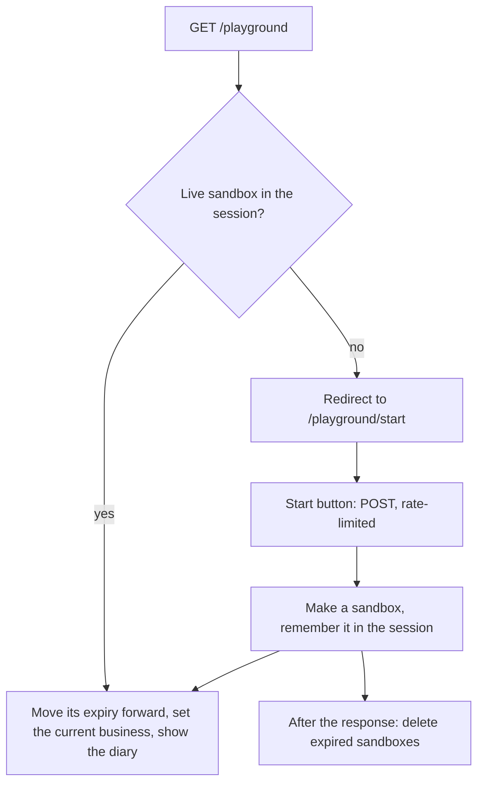

# 08 — Scheduling playground

## Goal

A public page, with no sign-up, where anyone can book appointments into a sample business, drag the strictness slider and see how the offered times and the day's efficiency change. It's the first part of Bookalive with real pages, and it makes the core idea live and shareable (the playground milestone).

## Depends on

03 to 07: the sample business and tenancy (03), the engine (04, 06 and 07) and `CreateBooking` (05). 01 and 02: the starter kit's pages, CI and deploys.

## Scope

**In scope**
- Sandboxes: made by a Start button, kept for the visitor's session, deleted once expired, and rate-limited
- The playground page: day timeline, dates, services, offered times and booking, the strictness slider and a slot interval picker, hidden times with reasons, waste scores, the relaxation notice, the day's figures, "Fill randomly" and "Reset"
- A 5-minute slot interval, alongside 10, 15, 20, 30 and 60, with the default still 15
- What the engine is missing for that page: the reason a time is hidden, the strictness that hides it, and a day's figures
- Laravel's lazy-loading guard
- Playwright end-to-end tests with axe accessibility checks, in CI
- A simple Bookalive home page, and a GIF of the playground in the README

**Out of scope**
- The scheduler Machine and container, which move to 12 (see **Decisions**)
- The custom domain, its own small piece of work before 09 (08b in the overview)
- Cancelling or moving one booking (12 and 13). "Reset" clears them all
- Prices on the page (10 or 11 shows the first), customer names on the timeline (13), and a second sample business (after 08)
- The logo and favicon, which are still the starter kit's. They go with the colours

**After the pages exist**, two short sessions with the user, each with its own pull request: tuning the strictness defaults, and the colours (see **Pull requests**).

## Decisions

The user's answers to this plan's questions (2026-11-25):

| Question | Answer |
|---|---|
| When a visitor's sandbox is made | **A Start button.** `/playground` without a sandbox leads to a short introduction with the button, which makes the sandbox with a POST. Link previews and crawlers rarely POST, no GET makes a business, and nothing has to draw a diary that doesn't exist yet. Making it automatically with JavaScript would make one for everyone who leaves at once, and making it on the first action would need a second way to draw the sample diary |
| Protecting the playground from bots | **Rate limits only.** No Turnstile in 08; it stays an open question for 11, where real bookings are at stake. A honeypot needs a typed form, and the playground has none |
| Laravel's lazy-loading guard | **On**, in development and tests |
| The custom domain | **Its own small piece of work just before 09.** Passkeys are tied to the domain, so it has to be settled before owners sign up. The playground launches on bookalive.fly.dev, and those links redirect to the domain later |
| How the playground shows the relaxation window | **Real dates and a notice** (the user's idea), in place of the overview's "how far ahead" control. The page opens on a day at least a week away, and a day inside the window says that every time is offered and why. A control that pretended it was two weeks, or a day, before the appointment was considered. It would have added an option to the booking code that nothing after the playground used, and a pretend time to explain to visitors |
| What a new sandbox's diary starts with | **No bookings.** The slider's effect is clearest on an empty day (see the table below), "Fill randomly" provides the crowd, and "Reset" simply clears the bookings |
| Deleting expired sandboxes | **When a new one is made.** Nothing runs on a timer and there's no extra Machine, so the scheduler waits for 12's reminders, which need it. The last few expired sandboxes stay until the next visitor starts one, and hold no personal data |
| The home page, still the starter kit's Laravel welcome | **A simple Bookalive page** with a button to the playground, in the last part, so nothing links to the playground until it's finished |

How many follow-up times the engine offers on an ordinary Monday, at each strictness (checked with the engine, as are the other numbers in this plan):

| Starting bookings | 0 | 25 | 50 | 75 | 90 | 100 |
|---|---|---|---|---|---|---|
| None | 28 | 28 | 26 | 13 | 8 | 4 |
| One assessment at 11:00 | 23 | 23 | 21 | 11 | 6 | 6 |
| The seeder's three | 13 | 13 | 13 | 9 | 7 | 7 |

**Added on 2026-11-26,** after part 1 was merged:

| Question | Answer |
|---|---|
| A 5-minute slot interval | **Allowed, with the default still 15, and a picker beside the slider** (see **The slot interval picker**). A 30-minute appointment with a 5-minute buffer takes 35 minutes, so on a 15-minute grid the next start is 10 minutes after its buffer ends: eight of them lose 80 minutes a day. A finer grid avoids that, but offers customers more times, some of them odd-looking (09:05). The picker lets the user compare the intervals on the sample business, and the tuning session chooses the default. Making 5 the default now was considered: 29 tests check the sample business's times and scores on the 15-minute grid, so they'd all change, and switching back would change them again. 03 left 5 out on 2026-10-30, because times like 09:05 look odd |

How many follow-up times the same empty Monday offers at each slot interval, also checked with the engine:

| Slot interval | 0 | 25 | 50 | 75 | 90 | 100 |
|---|---|---|---|---|---|---|
| 5 minutes | 80 | 80 | 70 | 17 | 8 | 4 |
| 10 minutes | 41 | 41 | 37 | 15 | 8 | 4 |
| 15 minutes (the default) | 28 | 28 | 26 | 13 | 8 | 4 |

Most of the in-between times have a lot of extra waste, so from strictness 75 a 5-minute grid offers about as many times as a 15-minute one.

## Design

### A visitor's sandbox

- A sandbox is a business from `CreateSampleBusiness` with `sandbox_expires_at` set. Its ID is kept in the visitor's session.
- **The expiry is the session's lifetime** (`config('session.lifetime')`, 120 minutes), moved forward on every playground request. Past its expiry a sandbox counts as gone, even before it's deleted.
- **Only a live sandbox can ever be the playground's business.** Every lookup requires `sandbox_expires_at` to be in the future, so a real business, whose column is null, can't be reached even if its ID got into the session. That's the playground's authorisation: there's no user, so there are no policies.
- **Two sessions never share a sandbox,** since the ID only lives in the session.

**The clean-up can't clash with a visitor.** 05 left 08 to decide what a visitor sees if deleting a sandbox deadlocks with a booking into it. It can't happen, because moving the expiry forward is one conditional update, `UPDATE ... WHERE id = ? AND sandbox_expires_at > now`, at the start of the request. Both orders were tried in PostgreSQL with two sessions:
- **The visitor first:** the clean-up's delete waits for the row, sees it has changed, and deletes nothing.
- **The clean-up first:** the visitor's update waits, then matches no row, and they're sent to the start page.

So no sandbox is deleted while a request is using it, and nothing needs to retry a deadlock. The clean-up deletes up to 50 at a time, so its delete has a `LIMIT 50` subquery, and it repeats the expiry test outside that subquery too. When a delete has waited for a row, PostgreSQL checks its conditions again against the row's new version, but not the subquery's: tried with two sessions while building part 2, the test in the subquery alone deleted a sandbox whose expiry the visitor had just moved forward.

### Real dates and the relaxation notice

The visitor moves between real dates, from today to the last bookable date (today plus 90 days):
- **The page opens on the first Monday at least 7 days from today.** A Monday is an ordinary day in both weeks of the sample pattern (09:00–13:00 and 14:00–17:30, with no time off), and is always outside the 48-hour window. Exactly 7 days could land on the sample's day off, half day or late Thursday.
- **Quick buttons:** "Next working day" (the first date after today with working hours), "In a week" (the opening day) and "In two weeks" (the Monday after it). Beside them are previous and next arrows, and a date field.
- **Today** only offers times at least the minimum notice away (2 hours), and the page says so.

A day inside the window shows a notice. It can make the comparison the pretend control would have made, because every time keeps its waste score:

> Every time that fits is offered, because this day is within 48 hours. Further ahead, strictness 75 would hide 13 of these 24 times.

Checked with the engine on an empty Monday at strictness 75, for the assessment: 11 offered and 13 hidden when seen 14, 7 or 3 days before, and all 24 offered the day before, of which the same 13 are over the threshold. The second sentence is left out when nothing would be hidden. On a day partly inside the window, the notice says where it ends: "Times up to 11:00 are within 48 hours, so all of them are offered." A line by the slider always explains the window, for the times when no working day is close enough to show it (from Friday 17:30 to Saturday 09:00 in the sample's first week).

### A slider that answers at once

The offered times have to change while the slider is dragged, so the page can't wait for the server at each step. The engine therefore says, for each time, **the lowest strictness that hides it** (`hiddenFrom`, or null if none does) and whether it's inside the relaxation window (`relaxed`). The page shows a time as hidden when it isn't relaxed and the slider is at or above its `hiddenFrom`. Letting go saves the strictness to the sandbox.

| Option | Trade-off |
|---|---|
| **The engine gives each time's `hiddenFrom` (chosen)** | Instant, and the threshold formula stays in one place, in the engine. It works because raising strictness only ever hides times (rule 14) |
| Ask the server at each step | No new engine code, but about 100ms behind the slider, and a request for every step |
| Work out the threshold in TypeScript | Instant, but a second copy of the formula that tuning would have to change too |

10's live preview ("18 start times next Tuesday, 32 at loosest") can use the same values.

### The slot interval picker

Beside the slider, a radio group labelled "Start times every" offers each of `BookingSettings::SLOT_INTERVALS` (5, 10, 15, 20, 30 and 60 minutes), with the sandbox's own selected. A new sandbox starts on 15, the default.
- **It saves, then the page reloads,** rather than answering at once like the slider. A new interval gives new start times, each with its own waste score, so only the engine can work them out. The free gaps' kinds can change too, since whether a gap is stranded or fragmented depends on the start times that fit in it (06).
- **Bookings already made stay where they are.** After a switch from 5 to 15 minutes, a booking at 09:05 is still blocked time. A booking sent from another tab for a time on the old grid is refused like a taken time.
- **"Reset" keeps it,** as it keeps the strictness.
- **A finer grid costs a little time.** One day's search for the sample business took a median of 9.4ms at 5 minutes, against 5.7ms at 15, and 31 days took 140ms against 54ms. A fill searches about 20 times, so at 5 minutes it should take about 80ms longer (an estimate).
- Owners will set their own in 10's business settings, which can reuse the component.

### Why a time is hidden

The reason compares the time with the best one in its free gap, since part of every score can't be avoided. `ExtraWaste` holds how the two differ: the extra stranded minutes, the kinds of appointment it takes more room from, and whether it splits the gap when the best doesn't. The page words it:
- "Leaves 15 minutes nobody can book", or "15 more minutes" when the best time strands some too
- "Leaves room for one fewer 90-minute appointment"
- "Splits this free time in two"

**Appointments are named by their length.** `lostRoom` names kinds by their times, and two services can share them, so "90-minute appointment" is always right. `OfferedService` needs no label.

**There's always a reason.** If no part were larger than the best time's, the score couldn't be larger either. A randomised rule checks it.

The best time is never hidden, so it's always among the day's `slots`. If several tie, the earliest is used.

### Fill randomly and Reset

**"Fill randomly"** sends 10 made-up customers to the day shown, one after another. Each wants a service, chosen in proportion to its room weight, which says how often it's booked (10, 10 and 5), and takes a random offered time. If none is offered, they're turned away. Each booking goes through `CreateBooking`, so a fill follows every rule a customer does. The page then says, for example, "7 of 10 customers booked. 3 found no time for their service."

The customers are different each time. That's enough to show the idea: over 200 fills of an empty Monday, 90% left stranded time at strictness 50, and none did at 75 or 90. Comparing the same customers at two settings is the simulator's job (20).

Locally, a fill took 135ms and 131 queries with 7 bookings made, so it has its own rate limit, and Nightwatch samples the playground (below).

**"Reset"** deletes every booking in the sandbox, on all days. The strictness, the slot interval, the service and the date stay as they are, so a visitor can fill, reset, move the slider and fill again.

### Rate limits

| Limiter | Applies to | Limit |
|---|---|---|
| `sandboxes` | `POST /playground/start` | 20 an hour for each IP address (an IPv6 address's /64 network), then 500 an hour in all |
| `playground` | the other writes | 120 a minute for each session |
| `playground-fill` | Fill randomly | 10 a minute for each session, as well |

- The limit for all visitors is a backstop, so the database can't fill. Laravel checks every limit before counting against any (checked in its source), so an address that's refused doesn't use it up. A flood from many addresses could use it up, and visitors would then see "The playground is busy" until the hour passes.
- 20 an hour allows for several people behind one office or mobile address.
- **An IPv6 address counts by its /64 network,** with `IpUtils::anonymize($ip, 0, 8)`, which keeps an IPv4 address whole. A connection is usually given a whole /64, so counting each IPv6 address on its own would let one visitor start 500 sandboxes from one connection and close the playground for an hour. Found in part 2's review; a /64 is one household or office, like one IPv4 address behind a router.
- Going over a limit redirects (303) to the page they were on, with a toast, rather than showing a bare 429. Each limit needs its own `response()`.
- The two `sandboxes` limits come from `config/playground.php` (`PLAYGROUND_SANDBOXES_PER_IP` and `PLAYGROUND_SANDBOXES_IN_ALL`), so `.env.example` can raise the first for the end-to-end tests, which start a sandbox each.
- The limiters use the database cache, which only visitors' requests touch, so Neon can sleep.

CSRF protection isn't counted on against bots: Laravel 13's `PreventRequestForgery` accepts any request whose `Sec-Fetch-Site` header is `same-origin` (checked in its source). The same rule means a visitor who comes back after 2 hours sees the start page rather than a 419 error.

### Nightwatch

Nightwatch counts each request, query and cache use as an event, and the Free plan has 300,000 a month. A fill is about 135 events, and a visitor could easily cause 900, so a few hundred visitors would use up the month. The playground's routes therefore use `Sample::rate(0.1)`, which records one request in ten. `Sample` goes before `ThrottleRequests` in the middleware priority list, so refused and redirected requests are sampled too (checked; otherwise it runs last, after them). Errors are still recorded, because Nightwatch samples exceptions separately (checked in its source). The 135 is measured, and the 900 is an estimate.

### Personal data

Visitors give none: no name, email or phone is asked for, and every booking belongs to one made-up customer at `example.com`. The session row holds the IP address and user agent, as for every page.

## Data model

**`businesses`** gains one column:

| Column | Type | Rules |
|---|---|---|
| `sandbox_expires_at` | timestamptz, nullable | null for every real business. A partial index on it, `WHERE sandbox_expires_at IS NOT NULL`, serves the clean-up |

Production has no businesses yet, and existing rows get null. `down()` drops the column.

**The check on `slot_interval_minutes`** (03's `businesses_slot_interval_minutes_check`) also allows 5, in a migration of its own in part 2. The column's default stays 15.
- `up()`: one `ALTER TABLE` drops the check and adds it again with 5, 10, 15, 20, 30 and 60. Every existing row already passes it.
- `down()`: moves any business on 5 to 15, the default, then puts back the old check, so a rollback can't fail on a sandbox. Until 10, only sandboxes can be on 5.
- Both were tried in PostgreSQL, in a transaction that was rolled back: after `up()`, 5 was accepted and 7 refused, and `down()` left the business on 15.

## Backend

### The engine (`app/Scheduling`, part 1)

Plain PHP, as before, tested without the database and covered by Infection.

- **`StrictnessFilter`:**
  - `public static function hiddenFrom(int $extraMinutes): ?int`: the lowest strictness from 1 to 100 whose `thresholdTenths()` the extra waste is over, or null if none is. It tries each strictness rather than turning the formula round, so there's still one formula
  - `public function relaxes(CarbonImmutable $startsAt): bool`: whether a time starting then is inside the relaxation window. `hides()` uses it
- **`ExtraWaste`** (`final readonly`): `strandedMinutes`, `lostRoom` (as `WasteScore`'s, with only the kinds it takes more of) and `splits`. Made with `ExtraWaste::between(WasteScore $slot, WasteScore $best): self`. Parts where the slot does better than the best are left out.
- **`DayAvailability::bestInGapOf(Slot $slot): Slot`**: the least wasteful slot in the same free gap, the earliest if several tie. It throws `InvalidArgumentException` for a slot that isn't the day's.
- **`DayFigures`** (`final readonly`): `workingMinutes`, `bookedMinutes`, `freeMinutes`, `strandedMinutes` and `fragmentedMinutes`, made with `DayFigures::of(DayAvailability $day, list<TimeRange> $appointments): self`. Booked minutes are the appointments' own times, without buffers. Free minutes are those in the day's free gaps, so buffers and time off aren't free time, as 06's notes for 14 say of blocked time. `efficiency(): ?int` is the overview's formula (5.6), `booked ÷ (booked + stranded)` as a whole percentage with halves rounded up, and null when both are 0. 14 uses it for the days it records.

In part 2, `BookingSettings::SLOT_INTERVALS` gains 5, with the database's check (**Data model**). It's the engine's only change after part 1. The randomised rules pick each scenario's interval from that list, so they try 5 as well.

### Models and services

- **`Business`:**
  - casts `sandbox_expires_at` with `AsUtcDateTime`. It's not fillable: `StartSandbox` sets it
  - scopes `liveSandbox(CarbonInterface $now)` (expiry after `$now`) and `expiredSandbox(CarbonInterface $now)` (at or before it). Null matches neither. Times are bound with their offset, as elsewhere
  - `isSandbox(): bool`
  - `bookingSettings(): BookingSettings`, moved out of `AvailabilityService::forService()`, which uses it
- **`Booking`** gains the scope `overlapping(string $from, string $until)`, the range test from `AvailabilityService::bookings()`, which then uses it. The page's bookings query shares it, and so will 13's.
- **`AvailabilityService::nextWorkingDate(Business $business, CarbonInterface $after): ?string`**: the first date after the given one with working hours, looking 28 days ahead (the longest pattern's cycle), or null. Three queries. Time off isn't considered.
- **The lazy-loading guard:** `Model::preventLazyLoading(! app()->isProduction())` in `AppServiceProvider::configureDefaults()`. All 661 tests pass with it on, unchanged.

### Sandboxes (part 2)

- **`App\Actions\Playground\StartSandbox`**, `handle(): Business`: makes the sample business and sets its expiry in one transaction, so a sample business without an expiry can never be left behind.
- **`App\Actions\Playground\DeleteExpiredSandboxes`**, `handle(): int`: deletes up to 50 expired sandboxes, oldest first, in one query, which repeats the expiry test outside its subquery (see **A visitor's sandbox**). The database's cascades take everything they own.
- **`App\Services\Playground\SandboxSession`**: the only class that knows the session key.
  - `current(): ?Business` finds the session's sandbox with the conditional update above, and forgets an ID that no longer has a live one
  - `remember(Business $sandbox): void`
  - `has(): bool`, whether the session remembers one, live or not. The middleware asks before `current()`, to know whether one has expired
- **`App\Http\Middleware\UseSandbox`**: sets `CurrentBusiness` from `SandboxSession`. With none, it redirects to the start page. If the session's sandbox had expired, or the request is an Inertia one (so the page was open), it flashes "Your playground ended after 2 hours without a visit. Start a new one to carry on."
  - It's put before `SubstituteBindings` in the middleware priority list with `prependToPriorityList()` in `bootstrap/app.php`, so route model binding sees the current business. Checked: it then runs after `StartSession` and `ThrottleRequests`, and a redirect after a PATCH is still a 303, because Inertia's `EnsureGetOnRedirect` is a global middleware.
- **Rate limiters** in `AppServiceProvider`, as above. Each comes with the first route it limits: `sandboxes` in part 2, `playground` with booking in part 4, and `playground-fill` in part 6.

### Routes (`routes/playground.php`, required by `routes/web.php`)

Every route has `Sample::rate(0.1)`. Those marked * also have `UseSandbox`.

| Route | Name | Controller (`App\Http\Controllers\Playground`) | Part |
|---|---|---|---|
| `GET /playground/start` | `playground.start` | `SandboxController@create` | 2 |
| `POST /playground/start` | `playground.start.store` | `SandboxController@store` | 2 |
| `GET /playground` * | `playground.show` | `DiaryController@show` | 2 |
| `POST /playground/bookings` * | `playground.bookings.store` | `BookingController@store` | 4 |
| `PUT /playground/strictness` * | `playground.strictness.update` | `StrictnessController@update` | 5 |
| `PUT /playground/slot-interval` * | `playground.slot-interval.update` | `SlotIntervalController@update` | 5 |
| `POST /playground/fill` * | `playground.fill` | `FillController` (invokable) | 6 |
| `POST /playground/reset` * | `playground.reset` | `ResetController` (invokable) | 6 |

- Both start routes redirect to the diary if the session already has a live sandbox, and the POST makes no second one. The button is disabled while it's working. If two presses still get through at once, the extra sandbox expires unused.
- `SandboxController@store` deletes expired sandboxes with Laravel's `defer()`, after the response is sent, so the visitor doesn't wait for it. `defer()` needs no queue, and a failure there is reported without reaching the visitor.
- Writes answer with `back()` and a toast, with `playground.show` as the fallback. The service and date are in the page's URL, so going back keeps them.

**Form Requests** (`App\Http\Requests\Playground`):
- **`ShowDiaryRequest`:** `service` (an active service of the current business) and `date` (`Y-m-d`, from today to the last bookable date in the business's time zone), both optional. `service()` and `date()` give the values or the defaults. An invalid query string redirects to the plain `/playground` (`$redirectRoute`), since redirecting back to the same URL would loop.
- **`StoreBookingRequest`:** `service_id`, and `starts_at` as `date_format:Y-m-d\TH:i:sp`, the form `toIso8601ZuluString()` gives (checked). The page sends back the string it was given.
- **`UpdateStrictnessRequest`:** an integer from 0 to 100.
- **`UpdateSlotIntervalRequest`:** an integer, one of `BookingSettings::SLOT_INTERVALS` (`Rule::in`), so the choices are defined in one place.
- **`FillDayRequest`:** `date`, with `ShowDiaryRequest`'s rule, shared through a trait.

`exists` rules don't use global scopes, so they name the current business's ID themselves.

### The diary page (parts 3 to 6)

- **`App\Services\Playground\PlaygroundDates`** (`final readonly`), from a business and now: `today`, `last`, `inAWeek` and `inTwoWeeks`, in the business's time zone.
- **`App\Services\Playground\DiaryDay`**, `describe(Business $business, Service $service, CarbonInterface $date): array`: the day's props, below. It runs `AvailabilityService::forService()` once and reads the day's bookings with their service. The whole page takes about 16 queries. The array's shape is in its PHPDoc, mirrored by `types/scheduling.ts`.
- **`App\Actions\Playground\BookAsSampleCustomer`**, `handle(Business, Service, CarbonInterface $startsAt): Booking`: calls `CreateBooking` with the one made-up customer and `BookingSource::Playground`. The controller and the fill both use it.
- **`App\Actions\Playground\FillRandomly`**, `handle(Business $business, CarbonInterface $date): FillResult`, holding how many booked and how many were turned away. It takes a `Random\Randomizer` from the container, so tests can give it a seeded one. A `SlotNotAvailable` part-way through, from another tab, counts as turned away.
- **`App\Actions\Playground\ResetSandbox`**, `handle(Business $sandbox): void`: deletes the sandbox's bookings in one query, scoped by the current business. It throws `LogicException` for a business that isn't a sandbox. It needs no lock: a booking made at the same moment simply lands before or after the reset.
- **`BookingController@store`** catches `SlotNotAvailable` and `ServiceNotBookable` and shows "Sorry, that time was just taken." with the updated times.

## Frontend

### Page props

`playground/Show` gets these. Instants are ISO 8601 strings in UTC, and the page formats them in the business's time zone, so positions and labels stay right when the clocks change.

| Prop | Holds | Part |
|---|---|---|
| `business` | name, time zone, strictness, relaxation hours, minimum notice | 2 |
| `services` | each active service's ID, name and length | 2 |
| `dates` | today, last, next working day, in a week, in two weeks | 3 |
| `day` | date, working times, free gaps (each usable, fragmented or stranded), bookings (ID, service name, start and end) | 3 |
| `serviceId`, `times` | each offered time's start and end | 4 |
| `times`, with the hidden ones | adds each time's waste score and its parts, how it differs from the best in its gap, `hiddenFrom` and `relaxed`; and when the relaxation window ends | 5 |
| `business`, with its slot interval, and `slotIntervals` | the sandbox's slot interval, and the choices from `BookingSettings::SLOT_INTERVALS` | 5 |
| `figures` | `DayFigures`, with the efficiency score | 6 |

Moving to another date or service is a GET with the new query string, as a partial reload that keeps the page's state and scroll position.

### Pages, layout and components

- **`layouts/PublicLayout.vue`:** the name linking home, a main area and the toaster. `app.ts` gives it to `playground/` pages, and to `Home` in part 7.
- **`pages/playground/Start.vue`:** what the playground is, in a few sentences, and the Start button. **`pages/playground/Show.vue`** holds the rest.
- **`pages/Home.vue`** replaces `Welcome.vue`: what Bookalive does, and a button to the playground. The button goes to `playground.start`, which goes on to the diary when there's a sandbox: an Inertia visit to `playground.show` without one would tell a new visitor their playground had ended. It has no sign-up or log-in links until 09.

| Component | Folder | Does | Part |
|---|---|---|---|
| `DayTimeline` | `components/scheduling` | the day's working times, bookings and free gaps on an hour scale | 3 |
| `DayPicker` | `components/playground` | arrows, quick buttons and a date field | 3 |
| `TimeOptions` | `components/scheduling` | the times, as a grid of buttons, or a list with scores and reasons when a toggle is on | 4, 5 |
| `StrictnessSlider` | `components/scheduling` | the slider, its ends labelled "Loosest" and "Tightest" | 5 |
| `SlotIntervalPicker` | `components/scheduling` | "Start times every", as a radio group beside the slider | 5 |
| `RelaxationNotice` | `components/scheduling` | the notice above | 5 |
| `DayFigures` | `components/scheduling` | booked, free, stranded and fragmented time, and the efficiency score | 6 |

`components/scheduling` holds what 10 and 13 will reuse. Beside them are `composables/scheduling/useLocalTime.ts` (formats instants in a time zone with `Intl`), `composables/scheduling/useOfferedTimes.ts` (offered, hidden and relaxed-but-over-the-threshold times at a strictness) and `lib/scheduling/extraWasteReasons.ts` (the reasons' wording).

From shadcn-vue: `slider`, `switch` and `radio-group`. They need no new npm packages, as `reka-ui` and `@vueuse/core` are installed. The registry also lists a dependency called `cn`, which here is the helper in `@/lib/utils`, so check that the CLI adds no package of that name.

### Behaviour

- **Dragging** changes the times at once. The strictness is saved 300ms after the last change (`useDebounceFn`), because holding an arrow key changes it many times a second. While a save is waiting or any request is running, the time buttons, Fill and Reset are disabled, so a booking is never checked against an older strictness.
- **Picking a slot interval** saves it straight away and reloads the times, the day and the figures. While it saves, the same buttons are disabled as during a strictness save.
- **The two toggles,** "Show hidden times" and "Show waste scores", are off at first, and only change what the page shows. Hidden times are greyed, can't be booked, and have their reason beside them as text.
- **A booking** shows a toast and updates the timeline. The button that was pressed disappears, so focus moves to the times' heading.
- **Days with nothing to offer** say why: not working that day, fully booked for this service, or too late today.

### Accessibility

- The timeline is an ordered list in time order, each item with its times and what it is in words ("10:00 to 10:15, 15 minutes nobody can book"). Colour is never the only sign: stranded time is hatched and labelled.
- Everything works from the keyboard: services and the slot interval are radio groups, and the slider takes arrow keys, Home and End.
- A polite live region says "13 of 28 times offered" once the slider settles, and again after a new slot interval loads.
- Axe finds no violations in light or dark mode, and animations follow `prefers-reduced-motion`.
- On a phone the panels stack, with no sideways scrolling.

### Colours

The timeline and times use new tokens in `app.css` (booked, free, fragmented, stranded, offered and hidden), in light and dark, starting from the starter kit's greys. The colours session then changes tokens, not components.

## Tests

PHP feature tests fix the time with `travelTo()`. Where no other is given, it's Wednesday 25 November 2026, 10:00 in London, which makes the opening day Monday 7 December.

**Unit: the engine** (`tests/Unit/Scheduling`)
- `StrictnessFilter::hiddenFrom()`: null for 0; 100 for 1; 51 for 60 and 50 for 61 (60 is exactly on the threshold at 50); 1 for 119 and for 500.
- `relaxes()`: a time exactly at the window's end is inside, a minute later isn't, and none after now is with 0 hours.
- `ExtraWaste`: each part on its own, parts where the slot is better left out, and nothing for the best time itself. The sample morning's 09:15 follow-up strands 15 minutes more than 09:00.
- `bestInGapOf()`: the earliest of several, per gap, for hidden and offered slots, and a slot from another day refused.
- `DayFigures`: a day with bookings, a stranded gap and time off; buffers left out of booked time; efficiency rounded half up, 100 with nothing stranded, and null with nothing at all.
- **Randomised rules,** added to `SlotFinderRulesTest`:
  - 20: every slot with extra waste above 0 differs from the best in its gap in at least one part
  - 21: a slot is hidden exactly when it isn't relaxed and the strictness is at or above its `hiddenFrom`, at both of the scenario's strictness values
- Infection stays at 90% or more, with 7 timeouts, and the rules test's time is checked against the 40-second timeout.

**Unit and database: 5 minutes** (part 2)
- `BookingSettings` and the table's check each accept 5 and still refuse 7. Their existing tests list the choices, so they change with it.
- The randomised rules try 5. Locally, with 5 in the list, every rule passed and the rules test took 14.8s, against 10.6s without it, with 520,120 assertions against 408,541. CI's runners have been up to about twice as slow as the host, which would make about 30s, under Infection's 40-second timeout. Part 2 checks the time in CI.
- The migration rolls back and runs again cleanly (`migrate:rollback --step=1`, then `migrate`).

**Feature: sandboxes**
- `/playground` with no sandbox redirects to the start page, and makes no business.
- Starting makes one business, with its practitioner, services and an expiry 120 minutes away, and redirects to the diary. Starting again, with a live sandbox, makes no more.
- A playground request moves the expiry forward. One past its expiry is refused, not revived, and the next page says why.
- **Isolation:** two sessions get two sandboxes. A booking with another sandbox's service ID is refused, and changes nothing in either. A session holding a real business's ID is sent to the start page.
- Starting deletes expired sandboxes and everything they own, 50 at most, and leaves live sandboxes and real businesses alone (`withoutDefer()`).
- If making the sample business fails part-way, nothing is left.
- Limits, set to small numbers with `config()` (CI's `.env` comes from `.env.example`, which raises one): a start over the limit for one address is refused with a toast and makes nothing, another address isn't affected, and the limit for all visitors applies.
- The lazy-loading guard is on in tests, and lazy loading a relation of one of several loaded models throws.

**Feature: the diary**
- The opening day and quick dates, from a Monday, a Saturday and a Sunday, and with now just before and just after midnight in London during summer time.
- Query strings: another service's ID, a past date, one past the last bookable date and a malformed one each redirect to `/playground`.
- The props for a known day: working times, gap kinds, bookings and times as instants in UTC.
- **The props agree with the engine:** at strictness 0, 50, 75 and 100, the times whose `hiddenFrom` and `relaxed` make them hidden are exactly the day's `hiddenSlots`.
- A day inside the relaxation window has every time `relaxed`, and a day partly inside has some.
- The query count is the same with 1 booking and 10.
- `nextWorkingDate()`: skips days off, follows edited days, gives null with no hours in 28 days, refuses a business that isn't the current one, and takes three queries.

**Feature: booking, strictness, fill and reset**
- Booking an offered time saves it with `BookingSource::Playground` and the made-up customer. A hidden time, a taken one and a malformed start are refused with nothing written.
- Saving a strictness changes only this sandbox's; -1, 101 and text are refused.
- Saving a slot interval changes only this sandbox's, and the opening day's follow-up then offers 70 times at 5 minutes and strictness 50, all on the 5-minute grid. 0, 7 and text are refused. Reset keeps the interval.
- A fill with a seeded `Randomizer` books only offered times, never overlapping, and counts those turned away. At strictness 100 it leaves no stranded time on an empty Monday. On a day off, all 10 are turned away.
- Reset deletes every booking in this sandbox and none in another, keeps the strictness, and refuses a business that isn't a sandbox.
- The fill's limit.

**Vitest:** `useOfferedTimes` (a time exactly at its `hiddenFrom`, and relaxed times), `useLocalTime` (summer and winter, and a zone other than the computer's), the reasons' wording (singular and plural), the notice's three forms, the timeline's items in words, and `TimeOptions` not booking a hidden time.

**Playwright, with axe on every page visited,** in light and dark mode:
- Start, then the diary (part 2).
- Moving between days with the keyboard (part 3).
- Booking a time updates the timeline and takes the time away (part 4).
- The End key on the slider changes the follow-up's times from 26 to 4 on the opening day, and showing hidden times gives reasons. Picking 5 minutes changes them from 26 to 70, and 15 changes them back (part 5).
- Fill, then Reset, changes the figures and back (part 6).
- The home page leads to the playground (part 7).
- From part 4, a booking made with the keyboard alone, and no sideways scrolling at a phone's width.

The end-to-end tests run at the real time, so they only use the opening day, which is always the same ordinary Monday. The relaxation window is tested with feature tests and Vitest, where the time can be fixed.

### Running Playwright

`@playwright/test` 1.65.1 and `@axe-core/playwright` 4.14.1 join as dev dependencies, the newest releases when part 2 was built (2026-11-26). axe was approved on 2026-10-27, and Playwright has been in the overview's stack from the start. Chromium only.
- Tests live in `tests/e2e/*.spec.ts`, with `playwright.config.ts` at the root and `npm run test:e2e` to run them. Vitest only reads `resources/js/**/*.test.ts`, so it leaves them alone. They have their own `tests/e2e/tsconfig.json`, which extends the app's and adds Node's types, and `npm run types:check` checks both. Adding Node's types to the app's `tsconfig.json`, as first planned, would have let code that runs in the browser use Node's globals without an error.
- **Locally** they run against http://localhost:8001. Each test makes its own sandbox, so the development database needs no reset. The browser is installed once with `npx playwright install chromium`. The Ubuntu packages it needs come from `npx playwright install-deps chromium` **(you)**, with no `sudo` in front, since Playwright asks for `sudo` itself. That has been done locally: 27 packages, installed on 2026-11-25 and checked against Playwright 1.65.1. A dry run listed a Chromium build for Ubuntu 26.04.
- **In CI** they're a step of the `checks` job after `composer ci:check`, so the required checks don't change and the build and database are reused. `npx playwright install --with-deps chromium` installs the browser and its packages. The step runs the migrations on the `testing` database and Playwright starts `php artisan serve --no-reload`, which passes the environment on (without `--no-reload`, `serve` drops most of it). It listens on 127.0.0.1, which the tests use in CI, since `localhost` can resolve to IPv6 first. The report is uploaded with `actions/upload-artifact` if a test fails.
- They aren't part of `composer ci:check`, as they need a running app and a browser. `CLAUDE.md` (through `.ai/guidelines/project.md`) and the README gain the command.

## Done when

- [x] 1. The engine's new tests pass, with Infection at 90% or more and the randomised rules 20 and 21 on five other seeds (part 1)
- [x] 2. The lazy-loading guard is on, with every test passing (part 1)
- [x] 3. A visitor can start a sandbox, and the isolation, expiry, clean-up and limit tests pass. A slot interval can be 5 minutes, with its tests (part 2)
- [ ] 4. Playwright and axe run in CI and locally (part 2)
- [ ] 5. The deploy of part 2 adds `sandbox_expires_at` and the new slot interval check on Neon, and starting a sandbox works on bookalive.fly.dev
- [ ] 6. The timeline and dates work, with their tests (part 3)
- [ ] 7. A visitor can book an offered time, with its tests (part 4)
- [ ] 8. The slider, the slot interval picker, hidden times, scores and notice work, with their tests (part 5)
- [ ] 9. The figures, Fill and Reset work, with their tests (part 6)
- [ ] 10. Every page passes axe in light and dark mode, and the keyboard and phone-width tests pass
- [ ] 11. The strictness defaults, the slot interval's default and the colours have each been looked at with the user, and the results recorded in `tracking.md`
- [ ] 12. The home page and the README's GIF are in (part 7), and `tracking.md` marks 08 as done and the playground milestone as reached
- [ ] 13. After part 7's deploy, the home page leads to a working playground on bookalive.fly.dev, and after a quiet spell Neon goes to sleep with sandboxes still in the database

## Pull requests

**Estimate:** about 2,700 lines of app code (PHP, Vue and TypeScript) and 2,500 of tests, with the slot interval added on 2026-11-26. That's far over one pull request, so it's split along the build order. The shadcn-vue components aren't counted.

| Part | Contains | App | Tests | Ticks |
|---|---|---|---|---|
| 1 | The engine's additions, `Business::bookingSettings()`, `nextWorkingDate()` and the lazy-loading guard | 270 | 500 | 1, 2 |
| 2 | Sandboxes, the `sandboxes` rate limit, the start page, a first diary page (the business and its services), the public layout, Playwright in CI, and a 5-minute slot interval | 590 | 520 | 3, 4 |
| 3 | The diary: dates and the timeline, with `Booking::overlapping()` and `ShowDiaryRequest` | 520 | 400 | 6 |
| 4 | Services, offered times and booking, with the `playground` rate limit | 380 | 300 | 7 |
| 5 | Strictness: the slider, the slot interval picker, hidden times with reasons, scores and the relaxation notice | 490 | 410 | 8 |
| 6 | The figures, Fill randomly and Reset, with the `playground-fill` rate limit | 320 | 250 | 9 |
| 7 | The home page, and the README with its GIF | 150 | 100 | 10, 12 |

- **Branches:** `feature/08-scheduling-playground-part-1` to `-part-7`, merged in order. Items 5 and 13 are checked after a merge.
- **Where it splits:** parts 1 and 2 are the only ones that change the engine, so Infection runs in CI for them. Part 2 changes it by adding 5 to the slot intervals, and also changes `ci.yml`. The 5-minute interval goes in part 2 rather than with its picker in part 5, so no later part needs Infection. Each later part adds one thing a visitor can do.
- **Safe to deploy:** `/playground` works at every step, with less on it, and nothing links to it until part 7.
- **Between parts 6 and 7,** two sessions with the user, each with its own pull request: `feature/08-tune-strictness` (which also settles the slot interval's default), then `feature/08-colours`. The GIF in part 7 then shows the final look. They tick 11.

## Notes

**For the tuning session.** The sample business shows the first versions need changing:
- **The bottom of the slider does nothing.** No time on an empty ordinary Monday, or on 150 randomly part-filled ones, had more than 74 minutes of extra waste. So with the 120-minute scale nothing is hidden below strictness 39.
- **The default of 50 hardly differs from 0.** Averages over 120 fills of 10 customers on an empty Monday (450 minutes):

| Strictness | 0 | 50 | 60 | 75 | 90 | 100 |
|---|---|---|---|---|---|---|
| Booked minutes | 363 | 362 | 388 | 398 | 420 | 436 |
| Stranded minutes | 40 | 38 | 29 | 0 | 0 | 0 |
| Efficiency | 90% | 91% | 93% | 100% | 100% | 100% |
| Turned away | 2.6 | 2.6 | 2.3 | 2.0 | 1.9 | 1.7 |

- **What to look at:** a smaller scale (about 75 would use the whole slider on this business), the default, and 06's constants. A change to the constants is a change to the engine, with Infection, and changes the numbers in 06, 07 and this plan's tests.
- Random customers who'd take any offered time flatter high strictness. Real ones may leave if their time isn't offered, which only the simulator (20) and real data can show.
- **The slot interval's default.** Compare 5, 10 and 15 minutes with the picker: the times offered (**Decisions**), and the figures after a few fills at each. Then choose the default. Changing it is a migration for the column's default and `Business`'s, and changes the sample business's tests: 29 of them at 5 minutes. On any grid, an appointment whose length and buffers aren't a multiple of the interval leaves the difference unused after it.

**For the colours session:** the overview's open question lists what it covers. The logo and favicon are the starter kit's, so decide whether they change then too.

**The GIF** is made from a Playwright recording, turned into a GIF with ffmpeg in a throwaway container (it isn't installed on the host). It goes in `docs/images/playground.gif`, under 5MB, with alt text.

**A sandbox's size** is bounded: one practitioner, 91 bookable dates, and a day of back-to-back follow-ups is 15 bookings on an ordinary day.

**For later sub-plans**
- **08b:** changing `APP_URL` changes the hosts Laravel trusts and the passkeys' domain. The old host must stay trusted for its redirect and for Fly's health checks, which send it.
- **10:** the settings screen reuses `StrictnessSlider`, `SlotIntervalPicker` and `RelaxationNotice`, and the preview can use `hiddenFrom`.
- **11:** Turnstile is still open. The public API sends offered times only, never `hiddenFrom` or the scores. Its limits for each address should count an IPv6 address by its /64 network, as the playground's do.
- **12:** adds the scheduler. It can call `DeleteExpiredSandboxes` too, if sandboxes ever need deleting sooner.
- **13:** the calendar grows from `DayTimeline`, and shares `Booking::overlapping()`.
- **14:** uses `DayFigures`, and decides how a no-show counts. It's given the appointments that start on the day: `Booking::overlapping()` tests blocked time, so it also finds one whose buffer alone reaches into the day.
